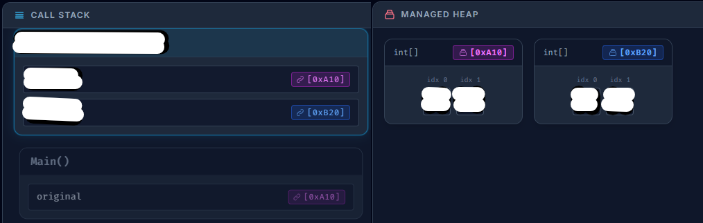

**Schriftliche Mitarbeitsüberprüfung - Referenztypen und Werttypen**
PoS - CAMM - 2CHIF - Gruppe A

**Name:** 
_ _ _ _ _ _ _ _ _ _ _ _ _ _ _ _ _ _ _ _ _ _ _ _ _ _ _ 
**Datum:** 
12.10.2026

## Aufgabe 1 - **Konzepte**
1. Welche *vier* *Eigenschaften* haben ``Variablen``? Wie verändern sich diese *Eigenschaften*, wenn wir ``Variablen`` mit ``Referenztypen`` und ``Werttypen`` vergleichen?
$\\$
$\\$
$\\$
$\\$
$\\$

1. Ein ``Call-Stack`` kann mehrere ``Stackframes`` besitzen. Was passiert mit ``Variablen`` in einem ``Stackframe``, wenn dieser ``Stackframe`` nicht an der obersten Stelle ist?
$\\$
$\\$
$\\$
$\\$
$\\$

## Aufgabe 2 - **Code Ausschnitt**
* Folgender Code ruft *zwei* ``Funktionen`` auf welche das ``Array`` *orginal* als ``Argument`` bekommen.

```csharp
static void Main() {
    int[] original = new int[] { 1, 2 };
    VeraendereArrayEins(original);
    VeraendereArrayZwei(original);
}
static void VeraendereArrayEins(int[] par) {
    int[] copy = par;
    copy[0] = 17; 
}
static void VeraendereArrayZwei(int[] par) {
    int[] copy = (int[]) par.Clone();
    copy[0] = 85;
}
```

Fülle die *weißen* Felder im unteren Bild aus. Betrachte dazu die ``Werte`` der ``Variablen`` im ``Call-Stack`` und die ``Speicheradresse`` im ``Managed-Heap``.

