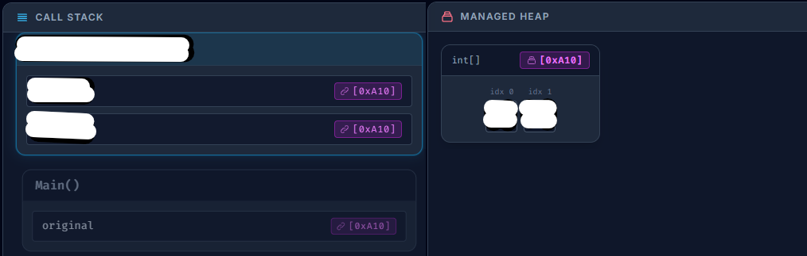

**Schriftliche Mitarbeitsüberprüfung - Referenztypen und Werttypen**
PoS - CAMM - 2CHIF - Gruppe B

**Name:** 
_ _ _ _ _ _ _ _ _ _ _ _ _ _ _ _ _ _ _ _ _ _ _ _ _ _ _ 
**Datum:** 
12.10.2026

## Aufgabe 1 - **Konzepte**
1. Fülle folgende Tabelle mit **einem passenden** ``Typ`` und/oder ``Keyword`` aus.
 
| | **Werttyp** | **Referenztyp** |
| :--- | :--- | :--- |
| **Werttypsemantik** | <br>______________________________<br><br>______________________________<br><br>____________________________<br><br> | <br>______________________________<br><br>____________________________<br><br>_____________________________<br><br> |
| **Referenztypsemantik** | <br>______________________________<br><br>______________________________<br><br>____________________________<br><br> | <br>______________________________<br><br>______________________________<br><br>___________________________<br><br> |

2. Was ist der Unterschied zwischen ``Referenztypen`` und ``Werttypen``?
$\\$
$\\$

## Aufgabe 2 - **Code Ausschnitt**
* Folgender Code ruft *zwei* ``Funktionen`` auf welche das ``Array`` *orginal* als ``Argument`` bekommen.

```csharp
static void Main() {
    int[] original = new int[] { 1, 2 };
    VeraendereArray1(original);
    VeraendereArray2(original);
}
static void VeraendereArray1(int[] arr) {
    int[] kopie = arr;
    kopie[0] = 99; 
}
static void VeraendereArray2(int[] arr) {
    int[] kopie = (int[]) arr.Clone();
    kopie[0] = 26;
}
```

Fülle die *weißen* Felder im unteren Bild aus. Betrachte dazu die ``Werte`` der ``Variablen`` im ``Call-Stack`` und die ``Speicheradresse`` im ``Managed-Heap``.

