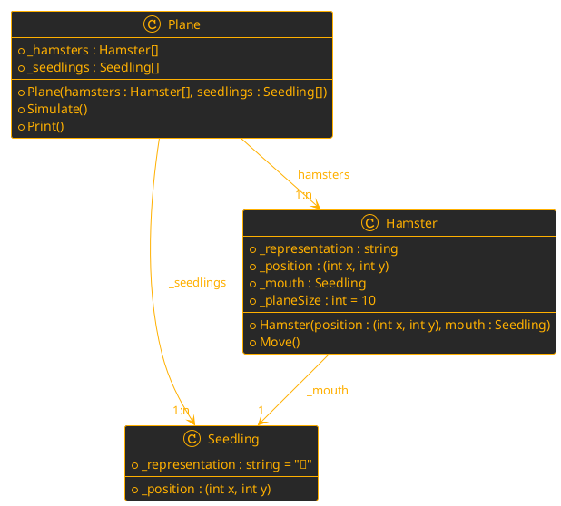

Welche ``Konzepte`` der Programmiersprache üben wir hier?
* Eigene ``Klassen`` in **eigenen Dateien** anlegen
* ``Felder``, ``Konstruktoren`` und ``Methoden`` nach einer Vorgabe (Klassendiagramm) **deklarieren**
* ``Objekte`` im Hauptprogramm erzeugen und verbinden
* ``Konstruktoren`` und ``Methoden`` **definieren** (den Inhalt schreiben)
* Die **hat-Beziehung**: Ein ``Objekt`` kennt ein anderes ``Objekt`` über ein ``Feld``
* Ein **Array von** ``Objekten``: ``Hamster[]``, ``Seedling[]``

Welche ``Denkweisen`` üben wir hier?
* Was ist ``Zustand`` (``Felder``), was ist ``Verhalten`` (``Methoden``)?
* Objekte **verbinden**: Wer kennt wen? Die Logik in den ``Methoden`` bleibt ganz klein.

Aufwand: ca. 1–2 Stunden. Eine Lösung findest du im Ordner [Loesung](Loesung/) – schau sie dir nur an, wenn du gar nicht weiterkommst. Grundlage sind die Folien [Klassen und Objekte](../Skripten/L04.1_KlassenUndObjekte.html), [Klassendiagramm und Objektdiagramm](../Skripten/L04.2_Klassendiagramm_Objektdiagramm.html) und das LiveCoding [L04HamsterObjekteUndKlassen](../../LiveCoding/L04HamsterObjekteUndKlassen/Hamster.cs).

>🎬 **Animation:** Die Animation zeigt, welche ``Objekte`` entstehen und wer wen kennt: [Animated-Slides-Hamster-v1.html](Animated-Slides-Hamster-v1.html) (im Browser öffnen).

>🐹 **Die Hamster-Reihe:** Das ist **Variante 1**: Wir bauen nur das **Gerüst** – die drei ``Klassen`` und wie ihre ``Objekte`` zusammenhängen. In [Variante 2](../Aufgabe05-Hamster-v2/Angabe.md) laufen die Hamster über ein gezeichnetes Spielfeld, in [Variante 3](../Aufgabe06-Hamster-v3/Angabe.md) laufen sie zufällig.

## Hamster v1
Drei Hamster 🐹 laufen auf einem 10 × 10 Spielfeld immer nach **Norden**. Oben angekommen, kommen sie unten wieder herein. Auf dem Spielfeld liegen acht Seedlings 🌱. Jeder Hamster trägt immer **genau einen** Seedling herum. Läuft er auf einen anderen Seedling, **tauscht** er: Ab jetzt trägt er den neuen herum, den alten lässt er **direkt hinter sich** liegen – auf dem Feld, von dem er gerade kommt.

| ``Klasse`` | ``Felder`` (``Zustand``) | ``Methoden`` (``Verhalten``) | hat-Beziehung |
|---|---|---|---|
| ``Seedling`` 🌱 | Darstellung, Position | – | – |
| ``Hamster`` 🐹 | Darstellung, Position, Seedling, den er herumträgt, Größe des Spielfelds | sich bewegen | **einen** Seedling (``_mouth``) |
| ``Plane`` (Spielfeld) | Array von Hamstern, Array von Seedlings | simulieren, die Hamster auflisten | **viele** Hamster (``_hamsters``), **viele** Seedlings (``_seedlings``) |

>Die hat-Beziehung ist **auch** ein ``Feld`` – deshalb steht sie in beiden Spalten. Die letzte Spalte zeigt nur, welche ``Felder`` auf **andere Objekte** zeigen.

>Wir schreiben vor jedes ``Feld`` einen ``_`` und verwenden kein ``this`` – siehe Folie *Namenskonvention* in [Klassen und Objekte](../Skripten/L04.1_KlassenUndObjekte.html).

### Klassendiagramm
>Wie man Klassendiagramme liest, steht in den Folien [Klassendiagramm und Objektdiagramm](../Skripten/L04.2_Klassendiagramm_Objektdiagramm.html).



---

## Teil 1 – Deklarieren: Dateien, Felder, Methodenköpfe und das Hauptprogramm
**Ziel:** Das Programm **kompiliert**. Es muss noch nichts Sinnvolles tun.

### Schritt 1 - level: 🙂 - Drei Dateien anlegen
Lege im Projekt drei neue Dateien an (Rechtsklick auf das Projekt → Hinzufügen → Klasse). In jeder Datei steht zuerst nur die leere ``Klasse`` mit den drei Kommentaren, die wir in **jede** ``Klasse`` schreiben – darunter kommen später die ``Felder``, der ``Konstruktor`` und die ``Methoden``. Hat eine ``Klasse`` keinen ``Konstruktor`` oder keine ``Methoden`` (wie der Seedling), schreib ``// (keiner)`` bzw. ``// (keine)`` darunter.

``Seedling.cs``
```csharp
class Seedling
{
    // Felder: der Zustand

    // Konstruktor: der Startzustand

    // Methoden: das Verhalten
}
```
``Hamster.cs``
```csharp
class Hamster
{
    // Felder: der Zustand

    // Konstruktor: der Startzustand

    // Methoden: das Verhalten
}
```
``Plane.cs``
```csharp
class Plane
{
    // Felder: der Zustand

    // Konstruktor: der Startzustand

    // Methoden: das Verhalten
}
```
>Die Datei heißt **gleich wie die ``Klasse``** darin. C# verlangt das nicht – wir machen es aber immer so, damit man jede ``Klasse`` sofort findet.

### Schritt 2 - level: 🙂 - Felder deklarieren
Schreib alle ``Felder`` aus dem Klassendiagramm in die ``Klassen``. Alle sind ``public``.
* ``Seedling``: ``_representation`` bekommt gleich bei der Deklaration den Wert ``"🌱"``. Einen ``Konstruktor`` hat der Seedling **nicht**.
* ``Hamster``: ``_mouth`` hat den ``Typ`` ``Seedling`` – das ist die **hat-Beziehung**. Schreib ``// hat-Beziehung`` dahinter (auch bei den beiden Arrays der ``Plane``). ``_planeSize`` bekommt gleich bei der Deklaration den Wert ``10``.
* ``Plane``: ``_hamsters`` ist ein **Array von Hamstern** (``Hamster[]``), ``_seedlings`` ein **Array von Seedlings** (``Seedling[]``).

### Schritt 3 - level: 🙂 - Konstruktoren und Methoden deklarieren
Schreib die **Köpfe** aller ``Konstruktoren`` und ``Methoden`` aus dem Klassendiagramm. Die Rümpfe ``{ }`` bleiben vorerst **leer**.

``Hamster.cs``
```csharp
public void Move()
{
}
```

### Schritt 4 - level: 🙂 - Das Hauptprogramm
Schreib in ``Program.cs``:
1. **Acht Seedlings.** Sie haben keinen ``Konstruktor`` – also ``new Seedling()`` und danach die Position mit dem **Punkt** setzen:
   ```csharp
   Seedling s1 = new Seedling();
   s1._position = (1, 5);
   ```
   Die Positionen: ``s1`` (1, 5), ``s2`` (1, 2), ``s3`` (4, 2), ``s4`` (4, 7), ``s5`` (4, 0), ``s6`` (7, 8), ``s7`` (7, 3), ``s8`` (9, 9).
2. Ein **Array** ``seedlings`` mit allen acht Seedlings.
3. Ein **Array** ``hamsters`` mit drei Hamstern. Jeder startet **auf** einem Seedling und trägt ihn schon herum:
   ```csharp
   new Hamster((1, 5), s1)
   ```
   Die anderen beiden: ``(4, 2)`` mit ``s3`` und ``(7, 8)`` mit ``s6``.
4. Eine ``Plane``, die beide Arrays bekommt.
5. Eine Endlosschleife: ``while (true)`` mit ``plane.Simulate();`` und ``Thread.Sleep(1000);``

Jetzt muss das Programm **ohne Fehler kompilieren**. Wenn du es startest, passiert noch nichts – alle ``Methoden`` sind noch leer. Beende es mit ``Strg + C``.

**Denk nach:** Warum meldet der Compiler einen Fehler, solange in ``Hamster`` der ``Konstruktor`` fehlt? Der Seedling hat doch auch keinen und ``new Seedling()`` geht trotzdem.

---

## Teil 2 – Definieren: die Inhalte schreiben
**Ziel:** Die Objekte sind **verbunden** und die Ausgabe stimmt. Jede ``Methode`` hat nur wenige Zeilen.

### Schritt 5 - level: 🙂 - Konstruktoren
* ``Hamster``: ``_representation`` ist ``"🐹"``. Speichere ``position`` und ``mouth`` in die ``Felder``. ``_planeSize`` setzt du hier **nicht** – das ist schon bei der Deklaration passiert.
* ``Plane``: Speichere ``hamsters`` in ``_hamsters`` und ``seedlings`` in ``_seedlings``.

#### Hash-IDs vergleichen
Jetzt sind die Objekte verbunden – das können wir sichtbar machen. Schreib im Hauptprogramm **nach** ``new Plane(...)`` und **vor** die Schleife:
```csharp
Console.WriteLine($"s2 hat die Hash-ID {s2.GetHashCode()}");
Console.WriteLine($"hamsters hat die Hash-ID {hamsters.GetHashCode()}");
Console.WriteLine($"plane._hamsters hat die Hash-ID {plane._hamsters.GetHashCode()}");
Console.WriteLine();
```
>``GetHashCode()`` ist eine ``Methode``, die **jedes** ``Objekt`` automatisch hat – wir müssen sie nicht selbst schreiben. Mit dem Punkt rufen wir sie bei dem ``Objekt`` auf, auf das die Variable zeigt: ``s2.GetHashCode()`` beim Seedling, ``hamsters.GetHashCode()`` beim Array. Bei ``plane._hamsters.GetHashCode()`` gehen wir zuerst mit dem Punkt zur ``Plane``, dann zu ihrem ``Feld`` ``_hamsters`` und rufen dort die ``Methode`` auf. Zurück kommt jedes Mal eine Zahl, die für **dieses** ``Objekt`` eindeutig ist: **gleiche Zahl = dasselbe Objekt**. Mehr dazu in den Folien [Klassendiagramm und Objektdiagramm](../Skripten/L04.2_Klassendiagramm_Objektdiagramm.html).

Erwarteter Output (die Zahlen sind bei dir andere):
```
s2 hat die Hash-ID 33826822
hamsters hat die Hash-ID 12479570
plane._hamsters hat die Hash-ID 12479570
```

**Denk nach:** Die ``Plane`` bekommt das Array aus dem Hauptprogramm. Gibt es danach **zwei** Arrays oder nur eines? Vergleich die zweite und die dritte Zeile. Die Hash-ID von ``s2`` brauchen wir in Schritt 7.

### Schritt 6 - level: 🙂 - ``Move()``
Der Hamster nimmt seinen Seedling mit und geht **einen Schritt nach Norden**:
* **Als Erstes** bekommt der Seedling, den er herumträgt, die Position des Hamsters: ``_mouth._position = _position;``
  >Über die hat-Beziehung ändern wir ein ``Feld`` eines **anderen** Objekts. Weil das **vor** dem Schritt passiert, liegt ein Seedling, den der Hamster gleich gegen einen neuen tauscht, **direkt hinter** dem Hamster – genau dort, wo er gerade war.
* Dann der Schritt: ``_position.y--;``
* Steht er schon ganz oben (``_position.y == 0``), setz ``_position.y`` **vorher** auf ``_planeSize`` – dann landet er nach dem ``--`` in der untersten Zeile ``9``.
>``Move()`` gibt nichts aus – was der Hamster gerade tut, zeigt ``Print()``.

### Schritt 7 - level: 🤔 - ``Simulate()`` und ``Print()``
* **``Simulate()``**: Geh mit ``foreach`` durch ``_hamsters``. Ruf bei jedem Hamster ``Move()`` auf. Geh danach mit einem zweiten ``foreach`` durch ``_seedlings``: Hat ein Seedling dieselbe ``_position`` wie der Hamster, **tauscht** der Hamster: Ab jetzt trägt er den neuen herum (``hamster._mouth = seedling;``), der alte bleibt **direkt hinter** dem Hamster liegen, auf dem Feld, das er gerade verlassen hat. Gib dabei aus:
  ```
  🐹 37200188 trägt jetzt 🌱 7043582 herum
  ```
  >Am Ende von ``Simulate()`` rufst du ``Print()`` auf.
* **``Print()``**: Geh mit ``foreach`` durch ``_hamsters``. Gib für jeden Hamster Darstellung, Hash-ID, Position und den Seedling, den er **herumträgt** (Darstellung, Hash-ID), aus. Den Seedling bekommst du über die hat-Beziehung: ``hamster._mouth``. Am Ende eine Leerzeile.
  ```
  🐹 28016690 auf (1, 4) trägt 🌱 28672654 herum
  ```

Erwarteter Output (die Hash-IDs sind bei dir andere Zahlen). Jeder Block ist **eine** Runde, also ein Aufruf von ``Simulate()``:
```
s2 hat die Hash-ID 33826822
hamsters hat die Hash-ID 12479570
plane._hamsters hat die Hash-ID 12479570

🐹 28016690 auf (1, 4) trägt 🌱 28672654 herum
🐹 37200188 auf (4, 1) trägt 🌱 13840400 herum
🐹 45707473 auf (7, 7) trägt 🌱 57326237 herum

🐹 37200188 trägt jetzt 🌱 7043582 herum
🐹 28016690 auf (1, 3) trägt 🌱 28672654 herum
🐹 37200188 auf (4, 0) trägt 🌱 7043582 herum
🐹 45707473 auf (7, 6) trägt 🌱 57326237 herum

🐹 28016690 trägt jetzt 🌱 33826822 herum
🐹 28016690 auf (1, 2) trägt 🌱 33826822 herum
🐹 37200188 auf (4, 9) trägt 🌱 7043582 herum
🐹 45707473 auf (7, 5) trägt 🌱 57326237 herum

🐹 28016690 auf (1, 1) trägt 🌱 33826822 herum
🐹 37200188 auf (4, 8) trägt 🌱 7043582 herum
🐹 45707473 auf (7, 4) trägt 🌱 57326237 herum
...
```
