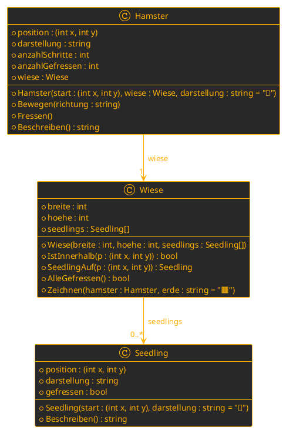

Welche ``Konzepte`` der Programmiersprache üben wir hier?
* Eigene ``Klassen`` schreiben: jede ``Klasse`` in einem eigenen File
* ``Felder`` für den ``Zustand``, ``Methoden`` für das ``Verhalten``
* ``Konstruktoren``, die den Startzustand festlegen – auch mit ``Default-Parametern``
* ``Objekte`` mit ``new`` erzeugen und mit dem **Punkt** ihre ``Mitglieder`` verwenden
* Die **hat-Beziehung**: ein ``Objekt`` kennt ein anderes ``Objekt`` über ein ``Feld``
* ``null``: „hier ist (noch) kein ``Objekt``“
* Wiederholung: Tupel ``(int x, int y)``, verschachtelte ``for``-Schleifen, ``Random``, ``Guard-Clauses``

Welche ``Denkweisen`` üben wir hier?
* Was **hat** ein Ding (``Felder``), was **kann** es (``Methoden``)?
* Wer ist **zuständig**? Die ``Wiese`` weiß, wo ihr Rand ist und was auf ihr steht. Der ``Hamster`` entscheidet, wohin er geht und ob er frisst.
* Ein ``Objekt`` muss nicht alles selbst wissen – es **fragt** das ``Objekt``, das es kennt: ``wiese.IstInnerhalb(ziel)``.

Aufwand: ca. 2 Stunden. Eine Lösung findest du im Ordner [Loesung](Loesung/) – schau sie dir nur an, wenn du gar nicht weiterkommst. Grundlage sind die Folien [Klassen und Objekte](../Skripten/L04.1_KlassenUndObjekte.html) und das LiveCoding [L04Hamster](../../LiveCoding/L04Hamster/Program.cs).

>🎬 **Animation:** Zu jedem Schritt gibt es eine Animation, die die Musterlösung an den echten Testdaten durchspielt – mit Objekten, Feldern, Pfeilen und der Wiese: [Animated-Slides-Hamsterwiese.html](Animated-Slides-Hamsterwiese.html) (im Browser öffnen).

>🐹 **Die Hamster-Reihe:** Das ist **Variante 1**. Die Hamsterwiese wächst mit uns mit: In Variante 2 speichert die Wiese ihre Felder in einem ``string[,]``, und am Ende steht die große Simulation mit vielen hungrigen Hamstern aus dem 3. Jahrgang ([Variante 4](../../../JahrGang3/L01Wiederholung/Aufgabe02-Hamster/Angabe.md)). Heute legen wir das Fundament: **eine** Wiese, **ein** Hamster, ein paar Seedlings – und noch **kein** 2D-Array.

## Die Hamsterwiese
Im LiveCoding hat sich unser Hamster nur eine Richtung **gemerkt** – seine ``position`` hat sich nie verändert. Jetzt bekommt er eine echte **Wiese**, auf der Seedlings 🌱 (Keimlinge) wachsen. Der Hamster läuft herum, stößt nicht über den Rand und frisst jeden Seedling, auf den er tritt.

| ``Klasse`` | hat (``Zustand``) | kann (``Verhalten``) |
|---|---|---|
| ``Seedling`` | Position, Darstellung, ob er schon gefressen wurde | sich beschreiben |
| ``Wiese`` | Breite, Höhe, **ihre Seedlings** | sagen, ob ein Punkt auf ihr liegt, einen Seedling auf einem Feld finden, prüfen, ob alle gefressen sind, sich zeichnen |
| ``Hamster`` | Position, Darstellung, Anzahl Schritte, Anzahl gefressen, **seine Wiese** | sich bewegen, fressen, sich beschreiben |

Die Files ``Seedling.cs``, ``Wiese.cs`` und ``Hamster.cs`` enthalten nur eine leere ``Klasse``. Fülle sie **Schritt für Schritt**. Zu jedem Schritt gibt es in ``Program.cs`` einen auskommentierten Testblock (``/* ---------- Test Schritt N ---------- ... */``). Entferne ``/*`` und ``*/``, starte das Programm und vergleiche mit dem **erwarteten Output**.

>Wie im Skriptum sind alle ``Mitglieder`` ``public`` und die ``Felder`` klein geschrieben. Wann wir ``Felder`` verstecken, lernen wir im nächsten Teil bei der *Datenkapselung*.

>Koordinaten: ``(0, 0)`` ist **oben links**. ``x`` ist die Spalte (nach rechts), ``y`` die Zeile (nach unten).

### Klassendiagramm
>Das Klassendiagramm besprechen wir später genauer. Lies es vorerst so: oben der Name, in der Mitte die ``Felder``, unten ``Konstruktor`` und ``Methoden``. Die Pfeile sind die hat-Beziehungen.


* Der **Hamster hat eine Wiese**: Er braucht sie, um zu fragen, wo der Rand ist und was auf einem Feld steht.
* Die **Wiese hat Seedlings**: ein ``Feld`` vom Typ ``Seedling[]``. Jeder Eintrag ist eine ``Referenz`` auf ein ``Seedling``-``Objekt``.
* Die Wiese kennt den Hamster **nicht**. Zum Zeichnen bekommt sie ihn als ``Parameter``.

---

### Schritt 1 - level: 🙂 - Klasse ``Seedling``
🎬 [Animation zu Schritt 1](Animated-Slides-Hamsterwiese.html#schritt1)

Schreibe in ``Seedling.cs``:
1. Drei ``Felder``: ``position``, ``darstellung``, ``gefressen`` (Typen siehe Klassendiagramm).
2. Einen ``Konstruktor`` mit der Startposition und der Darstellung. Die Darstellung ist ein ``Default-Parameter`` mit dem Wert ``"🌱"``. Ein neuer Seedling ist noch **nicht** gefressen.
3. ``string Beschreiben()`` liefert z. B. ``🌱 auf (2, 0)``. Ist der Seedling gefressen, hängt sie `` (gefressen)`` an.

>Ein Tupel kannst du direkt in einen String einbauen: ``$"{position}"`` ergibt ``(2, 0)``.

**Denk nach:** Nach ``s2.gefressen = true;`` ist ``s1`` immer noch nicht gefressen. Warum?

Erwarteter Output (Test Schritt 1):
```
--- Schritt 1 ---
🌱 auf (2, 0)
🌱 auf (4, 1)
🌱 auf (2, 0)
🌱 auf (4, 1) (gefressen)
🌼 auf (0, 3)
```

### Schritt 2 - level: 🤔 - Klasse ``Wiese``
🎬 [Animation zu Schritt 2](Animated-Slides-Hamsterwiese.html#schritt2)

Schreibe in ``Wiese.cs``:
1. Die drei ``Felder`` aus dem Klassendiagramm.
2. Den ``Konstruktor`` ``Wiese(int breite, int hoehe, Seedling[] seedlings)``. Er merkt sich alle drei Werte.
3. ``bool IstInnerhalb((int x, int y) p)`` – liegt der Punkt auf der Wiese? (``0 <= x < breite`` und ``0 <= y < hoehe``)
4. ``Seedling SeedlingAuf((int x, int y) p)`` – geht mit ``foreach`` durch ``seedlings`` und liefert den **ersten noch nicht gefressenen** Seedling auf diesem Feld. Steht dort keiner, liefert die Methode ``null``.
   >Zwei Tupel vergleichst du direkt: ``seedling.position == p``.
5. ``bool AlleGefressen()`` – ``true``, wenn **jeder** Seedling gefressen ist.
6. ``void Zeichnen(Hamster hamster, string erde = "🟫")``
   - zwei verschachtelte ``for``-Schleifen: außen die Zeilen ``y``, innen die Spalten ``x``
   - für jedes Feld: ``string feld = erde;``
   - frag die **eigene** ``Methode`` ``SeedlingAuf((x, y))``. Liefert sie nicht ``null``, ist ``feld`` die ``darstellung`` des Seedlings.
   - ist ``hamster`` nicht ``null`` und steht er auf ``(x, y)``, ist ``feld`` seine ``darstellung`` (er liegt **oben drauf**)
   - ``Console.Write(feld);`` – am Ende jeder Zeile ``Console.WriteLine();``
   >Wir brauchen **kein** 2D-Array: Für jedes Feld fragen wir einfach nach, was dort steht.

>Den ``Hamster`` gibt es noch nicht – darum testen wir mit ``Zeichnen(null)``. Damit ``Wiese.cs`` kompiliert, braucht die leere ``Klasse`` ``Hamster`` aber schon die ``Felder`` ``position`` und ``darstellung``. Lege sie jetzt schon an.

Erwarteter Output (Test Schritt 2):
```
--- Schritt 2 ---
6 x 4
True False False
🌱 auf (1, 2)
True
False
🟫🟫🌱🟫🟫🟫
🟫🟫🟫🟫🌱🟫
🟫🌱🟫🟫🟫🟫
🟫🟫🟫🟫🟫🌱
```

### Schritt 3 - level: 🤔 - Klasse ``Hamster``: sich bewegen
🎬 [Animation zu Schritt 3](Animated-Slides-Hamsterwiese.html#schritt3)

Schreibe in ``Hamster.cs``:
1. Die fünf ``Felder`` aus dem Klassendiagramm. ``wiese`` ist die **hat-Beziehung**.
2. Den ``Konstruktor`` ``Hamster((int x, int y) start, Wiese wiese, string darstellung = "🐹")``. Die beiden Zähler starten bei ``0``.
3. ``string Beschreiben()`` liefert z. B. ``🐹 auf (1, 1), 2 Schritte, 0 gefressen``.
4. ``void Bewegen(string richtung)``
   - Berechne aus ``position`` und ``richtung`` das ``ziel``: ``"N"`` → ``y - 1``, ``"S"`` → ``y + 1``, ``"O"`` → ``x + 1``, ``"W"`` → ``x - 1``.
   - **Guard:** Frag die **Wiese**, ob das Ziel auf ihr liegt: ``wiese.IstInnerhalb(ziel)``. Wenn nicht, gib ``🐹 stößt im N an den Rand und bleibt auf (0, 0)`` aus und beende die ``Methode``.
   - Sonst: ``position`` auf ``ziel`` setzen, ``anzahlSchritte`` erhöhen und ``🐹 Schritt 1: geht nach S -> (0, 1)`` ausgeben.

**Denk nach:** Der Hamster weiß nicht, wie groß die Wiese ist. Woher bekommt er die Antwort? Was würde passieren, wenn ``wiese`` ``null`` wäre?

Erwarteter Output (Test Schritt 3):
```
--- Schritt 3 ---
🐹 auf (0, 0), 0 Schritte, 0 gefressen
🐹 stößt im N an den Rand und bleibt auf (0, 0)
🐹 Schritt 1: geht nach S -> (0, 1)
🐹 Schritt 2: geht nach O -> (1, 1)
🐹 auf (1, 1), 2 Schritte, 0 gefressen
True
🟫🟫🌱🟫🟫🟫
🟫🐹🟫🟫🌱🟫
🟫🌱🟫🟫🟫🟫
🟫🟫🟫🟫🟫🌱
```

### Schritt 4 - level: 😵‍💫 - Klasse ``Hamster``: fressen
🎬 [Animation zu Schritt 4](Animated-Slides-Hamsterwiese.html#schritt4)

1. ``void Fressen()``
   - Frag die Wiese: ``Seedling seedling = wiese.SeedlingAuf(position);``
   - **Guard:** Ist ``seedling`` ``null``, gibt es hier nichts zu fressen → ``return``.
   - Sonst: ``seedling.gefressen = true``, ``anzahlGefressen`` erhöhen und ``🐭 frisst 🌱 auf (2, 0) - schon 1 gefressen`` ausgeben.
2. Ruf ``Fressen()`` am Ende von ``Bewegen`` auf – aber nur nach einem **erfolgreichen** Schritt.

**Denk nach:**
* ``Fressen`` setzt ``seedling.gefressen`` – ein ``Feld`` eines **anderen** ``Objekts``. Warum ist danach auch in ``beet4[0]`` der Seedling gefressen, obwohl der Hamster ``beet4`` nie gesehen hat?
* Der ``gast`` steht auf ``(2, 0)`` und frisst trotzdem nichts. Warum?

Erwarteter Output (Test Schritt 4):
```
--- Schritt 4 ---
🐭 Schritt 1: geht nach O -> (1, 0)
🐭 Schritt 2: geht nach O -> (2, 0)
🐭 frisst 🌱 auf (2, 0) - schon 1 gefressen
🐭 Schritt 3: geht nach S -> (2, 1)
🐭 Schritt 4: geht nach O -> (3, 1)
🐭 Schritt 5: geht nach O -> (4, 1)
🐭 frisst 🌱 auf (4, 1) - schon 2 gefressen
🐭 Schritt 6: geht nach S -> (4, 2)
🐭 Schritt 7: geht nach S -> (4, 3)
🐭 Schritt 8: geht nach O -> (5, 3)
🐭 frisst 🌱 auf (5, 3) - schon 3 gefressen
🐭 auf (5, 3), 8 Schritte, 3 gefressen
🌱 auf (2, 0) (gefressen)
False
🟫🟫🟫🟫🟫🟫
🟫🟫🟫🟫🟫🟫
🟫🌱🟫🟫🟫🟫
🟫🟫🟫🟫🟫🐭
0
```

### Schritt 5 - level: 🙂 - Die Simulation
🎬 [Animation zu Schritt 5](Animated-Slides-Hamsterwiese.html#schritt5)

Der Testblock für Schritt 5 ist fertig. Lies ihn durch, bevor du ihn startest:
* 6 Seedlings bekommen **zufällige** Positionen auf einer 10 × 6 Wiese.
* Der Hamster startet oben links und geht **zufällig** – so lange, bis ``wiese.AlleGefressen()`` ``true`` liefert.
* Nach jedem Schritt wird die Wiese neu gezeichnet.

**Denk nach:** Zwei Seedlings können zufällig auf **demselben** Feld landen. Warum endet die Simulation trotzdem? (Tipp: ``SeedlingAuf`` liefert nur **nicht gefressene** Seedlings.)

### Zusatzaufgaben ⭐
* ⭐ Zähl in ``Bewegen`` auch die Schritte, bei denen der Hamster an den Rand stößt, in einem eigenen ``Feld`` ``anzahlRandstoesse``.
* ⭐⭐ Ein zweiter Hamster 🐭 auf **derselben** Wiese: Beide gehen abwechselnd. Wer frisst mehr? Was musst du an ``Zeichnen`` ändern? (Tipp: ein zweiter ``Parameter``.)
* ⭐⭐ ``Seedling`` bekommt eine ``Methode`` ``Wachsen()``: Ein gefressener Seedling wächst mit ``Random`` mit 5 % Wahrscheinlichkeit nach. Die Wiese ruft in jeder Runde für alle Seedlings ``Wachsen()`` auf. Endet die Simulation noch immer?
