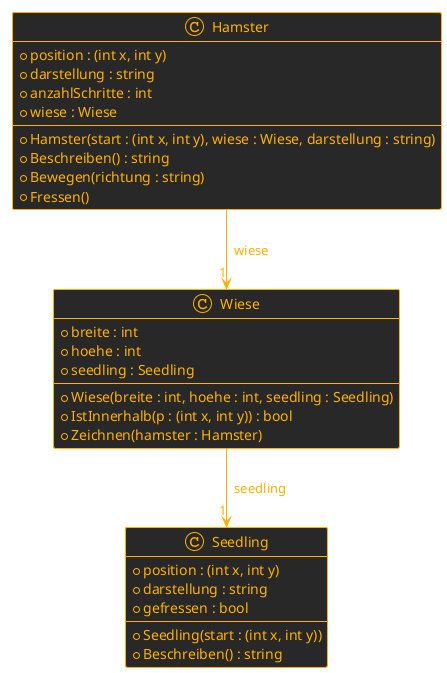

Welche ``Konzepte`` der Programmiersprache üben wir hier?
* ``Konstruktoren`` schreiben, die den Startzustand festlegen
* ``Methoden`` schreiben, die mit den **eigenen** ``Feldern`` arbeiten
* ``Objekte`` mit ``new`` erzeugen und mit dem **Punkt** ihre ``Mitglieder`` verwenden
* Die **hat-Beziehung**: ein ``Objekt`` kennt ein anderes ``Objekt`` über ein ``Feld``
* ``null``: „hier ist kein ``Objekt``“
* Wiederholung: Tupel ``(int x, int y)``, verschachtelte ``for``-Schleifen, ``Guard-Clauses``

Welche ``Denkweisen`` üben wir hier?
* Was **hat** ein Ding (``Felder``), was **kann** es (``Methoden``)?
* Ein ``Objekt`` muss nicht alles selbst wissen – es **fragt** das ``Objekt``, das es kennt: ``wiese.IstInnerhalb(ziel)``.

Aufwand: ca. 1–2 Stunden. Eine Lösung findest du im Ordner [Loesung](Loesung/) – schau sie dir nur an, wenn du gar nicht weiterkommst. Grundlage sind die Folien [Klassen und Objekte](../Skripten/L04.1_KlassenUndObjekte.html) und das LiveCoding [L04Hamster](../../LiveCoding/L04Hamster/Program.cs).

>🎬 **Animation:** Zu jedem Schritt gibt es eine Animation, die die Musterlösung an den Testdaten durchspielt: [Animated-Slides-Hamsterwiese.html](Animated-Slides-Hamsterwiese.html) (im Browser öffnen).

>🐹 **Die Hamster-Reihe:** Das ist **Variante 1**: **eine** Wiese, **ein** Hamster, **ein** Seedling. In Variante 2 kommen mehr Seedlings und ein ``string[,]`` dazu, und am Ende steht die große Simulation aus dem 3. Jahrgang ([Variante 4](../../../JahrGang3/L01Wiederholung/Aufgabe02-Hamster/Angabe.md)).

## Die Hamsterwiese
Im LiveCoding hat sich unser Hamster nur eine Richtung **gemerkt** – seine ``position`` hat sich nie verändert. Jetzt bekommt er eine echte **Wiese**, auf der ein Seedling 🌱 (Keimling) wächst. Der Hamster läuft herum, stößt nicht über den Rand und frisst den Seedling, wenn er auf ihn tritt.

| ``Klasse`` | hat (``Zustand``) | kann (``Verhalten``) |
|---|---|---|
| ``Seedling`` | Position, Darstellung, ob er gefressen wurde | sich beschreiben |
| ``Wiese`` | Breite, Höhe, **ihren Seedling** | sagen, ob ein Punkt auf ihr liegt, sich zeichnen |
| ``Hamster`` | Position, Darstellung, Anzahl Schritte, **seine Wiese** | sich beschreiben, sich bewegen, fressen |

### So arbeitest du
* In ``Seedling.cs``, ``Wiese.cs`` und ``Hamster.cs`` sind die ``Felder`` und die **Köpfe** aller ``Methoden`` schon fertig. Du schreibst nur die Inhalte – überall dort, wo ``// TODO`` steht.
* ``Program.cs`` ist **fertig**. Es ruft von Anfang an **alle** ``Methoden`` auf. Starte das Programm nach jedem Schritt und vergleiche mit dem **erwarteten Output**. Am Anfang steht noch überall ``TODO``, ``0`` oder ``False`` – mit jedem Schritt stimmt mehr.

>Koordinaten: ``(0, 0)`` ist **oben links**. ``x`` ist die Spalte (nach rechts), ``y`` die Zeile (nach unten).

### Klassendiagramm
>Das Klassendiagramm besprechen wir später genauer. Lies es vorerst so: oben der Name, in der Mitte die ``Felder``, unten ``Konstruktor`` und ``Methoden``. Die Pfeile sind die hat-Beziehungen.



---

### Schritt 1 - level: 🙂 - ``Seedling``
🎬 [Animation zu Schritt 1](Animated-Slides-Hamsterwiese.html#schritt1)

1. **Konstruktor:** ``position`` bekommt ``start``, ``darstellung`` ist ``"🌱"``, ``gefressen`` ist ``false``.
2. **``Beschreiben()``** liefert ``🌱 auf (2, 1)``. Ist der Seedling gefressen, kommt `` (gefressen)`` dazu.
   >Ein Tupel kannst du direkt in einen String einbauen: ``$"{darstellung} auf {position}"``.

**Denk nach:** Nach ``s2.gefressen = true;`` ist ``s1`` immer noch nicht gefressen. Warum?

Erwarteter Output:
```
--- Schritt 1 ---
🌱 auf (2, 1)
🌱 auf (4, 3)
🌱 auf (2, 1)
🌱 auf (4, 3) (gefressen)
```

### Schritt 2 - level: 🙂 - ``Wiese``
🎬 [Animation zu Schritt 2](Animated-Slides-Hamsterwiese.html#schritt2)

1. **Konstruktor:** alle drei Parameter in die ``Felder`` speichern. Weil sie gleich heißen, brauchst du ``this``: ``this.breite = breite;``
2. **``IstInnerhalb(p)``** liefert ``true``, wenn ``0 <= p.x < breite`` **und** ``0 <= p.y < hoehe``.
3. **``Zeichnen(hamster)``**: Zwei ``for``-Schleifen – außen die Zeilen ``y``, innen die Spalten ``x``. Für jedes Feld:
   - ``string feld = "🟫";``
   - Ist der ``seedling`` **nicht** gefressen und steht er auf ``(x, y)``? → ``feld = seedling.darstellung;``
   - Ist ``hamster`` **nicht** ``null`` und steht er auf ``(x, y)``? → ``feld = hamster.darstellung;``
   - ``Console.Write(feld);`` – nach jeder Zeile ``Console.WriteLine();``
   >Zwei Tupel vergleichst du direkt: ``seedling.position == (x, y)``.

**Denk nach:** Im Hauptprogramm steht ``wiese.Zeichnen(null)``. Was bedeutet das ``null``? Was würde passieren, wenn du in ``Zeichnen`` die Prüfung ``hamster != null`` weglässt?

Erwarteter Output:
```
--- Schritt 2 ---
6 x 4
True
False
False
🟫🟫🟫🟫🟫🟫
🟫🟫🌱🟫🟫🟫
🟫🟫🟫🟫🟫🟫
🟫🟫🟫🟫🟫🟫
```

### Schritt 3 - level: 🤔 - ``Hamster``: sich bewegen
🎬 [Animation zu Schritt 3](Animated-Slides-Hamsterwiese.html#schritt3)

1. **Konstruktor:** alle drei Parameter in die ``Felder`` speichern.
2. **``Beschreiben()``** liefert ``🐹 auf (0, 0), 0 Schritte``.
3. **``Bewegen(richtung)``**
   - ``(int x, int y) ziel = position;`` – dann je nach Richtung: ``"N"`` → ``ziel.y--``, ``"S"`` → ``ziel.y++``, ``"O"`` → ``ziel.x++``, ``"W"`` → ``ziel.x--``
   - **Guard:** Frag **deine Wiese**: ``if (!wiese.IstInnerhalb(ziel))`` → ``🐹 stößt an den Rand`` ausgeben und ``return``.
   - Sonst: ``position = ziel;``, ``anzahlSchritte++;`` und ``🐹 geht nach O -> (1, 0)`` ausgeben.

**Denk nach:** Der Hamster weiß nicht, wie groß die Wiese ist. Woher bekommt er die Antwort?

Erwarteter Output (noch ohne Fressen):
```
--- Schritt 3 und 4 ---
🐹 auf (0, 0), 0 Schritte
🐹 stößt an den Rand
🐹 geht nach O -> (1, 0)
🐹 geht nach O -> (2, 0)
🐹 geht nach S -> (2, 1)
🐹 geht nach O -> (3, 1)
🐹 geht nach W -> (2, 1)
🐹 auf (2, 1), 5 Schritte
🌱 auf (2, 1)
🟫🟫🟫🟫🟫🟫
🟫🟫🐹🟫🟫🟫
🟫🟫🟫🟫🟫🟫
🟫🟫🟫🟫🟫🟫
```

### Schritt 4 - level: 🤔 - ``Hamster``: fressen
🎬 [Animation zu Schritt 4](Animated-Slides-Hamsterwiese.html#schritt4)

1. **``Fressen()``**
   - Hol dir den Seedling über die Wiese: ``Seedling seedling = wiese.seedling;``
   - **Guard:** Ist er schon gefressen **oder** steht er **nicht** auf deiner ``position``? → ``return``
   - Sonst: ``seedling.gefressen = true;`` und ``🐹 frisst 🌱`` ausgeben.
2. Ruf ``Fressen();`` als **letzte** Zeile in ``Bewegen`` auf.

**Denk nach:** ``Fressen`` ändert ein ``Feld`` des Seedlings. Warum zeigt danach auch ``s1.Beschreiben()`` im Hauptprogramm ``(gefressen)``? Der Hamster hat ``s1`` doch nie gesehen!

Erwarteter Output:
```
--- Schritt 3 und 4 ---
🐹 auf (0, 0), 0 Schritte
🐹 stößt an den Rand
🐹 geht nach O -> (1, 0)
🐹 geht nach O -> (2, 0)
🐹 geht nach S -> (2, 1)
🐹 frisst 🌱
🐹 geht nach O -> (3, 1)
🐹 geht nach W -> (2, 1)
🐹 auf (2, 1), 5 Schritte
🌱 auf (2, 1) (gefressen)
🟫🟫🟫🟫🟫🟫
🟫🟫🐹🟫🟫🟫
🟫🟫🟫🟫🟫🟫
🟫🟫🟫🟫🟫🟫
```

### Schritt 5 - level: 🙂 - Die Simulation
🎬 [Animation zu Schritt 5](Animated-Slides-Hamsterwiese.html#schritt5)

Drück ``Enter``. Der Seedling bekommt eine **zufällige** Position, und die Maus 🐭 läuft **zufällig** herum, bis sie ihn gefressen hat (höchstens 500 Runden). Du musst hier nichts programmieren – lies den Code in ``Program.cs`` und beantworte:
* Welche ``Objekte`` werden erzeugt? Wer kennt wen?
* Warum endet die ``while``-Schleife, sobald die Maus frisst? Sie prüft doch ``futter.gefressen`` – und ``futter`` verwendet die Maus nie direkt.

### Zusatzaufgaben ⭐
* ⭐ ``Hamster`` bekommt ein ``Feld`` ``anzahlRandstoesse``. Zähle mit, wie oft er an den Rand stößt, und gib es in ``Beschreiben()`` aus.
* ⭐⭐ Ein zweiter Hamster auf **derselben** Wiese. Beide gehen in der Simulation abwechselnd. Wer frisst den Seedling? Was musst du an ``Zeichnen`` ändern?
