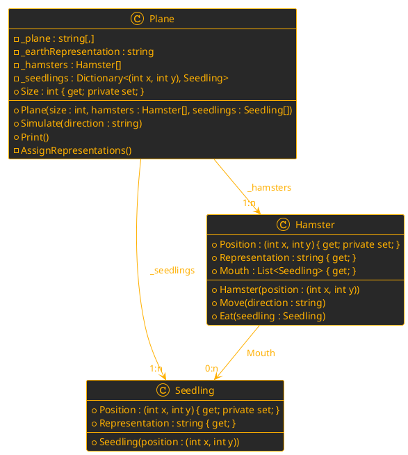

Welche ``Konzepte`` der Programmiersprache üben wir hier?
* ``Properties`` statt öffentlicher ``Felder``: ``public (int x, int y) Position { get; private set; }``
* ``private`` ``Felder`` mit ``_`` am Anfang
* Ein **2D-Array** als Spielfeld: ``string[,]``
* hat-Beziehungen zu **vielen** Objekten: ``List<Seedling>`` im Hamster, ``Dictionary<(int x, int y), Seedling>`` in der ``Plane``
* Wiederholung: ``foreach``, ``Guard-Clauses``

Welche ``Denkweisen`` üben wir hier?
* Wer **hat** was? Der Hamster hat **seine** Seedlings im Mund, die ``Plane`` hat die Seedlings, die noch auf dem Spielfeld liegen.
* Warum ein ``Dictionary``? Die ``Plane`` will schnell wissen: Liegt **auf dieser Position** ein Seedling?

Aufwand: ca. 1–2 Stunden. Eine Lösung findest du im Ordner [Loesung](Loesung/) – schau sie dir nur an, wenn du gar nicht weiterkommst.

>🐹 **Die Hamster-Reihe:** Das ist **Variante 2**. In [Variante 1](../Aufgabe01-Hamster-v1/Angabe.md) haben wir die drei Klassen angelegt und verbunden. Jetzt laufen die Hamster wirklich über ein Spielfeld und fressen. In [Variante 3](../Aufgabe06-Hamster-v3/Angabe.md) laufen sie dann zufällig und fragen die ``Plane``, wohin sie dürfen.

## Hamster v2
Alle Hamster gehen **gemeinsam** einen festen Weg: rechts, rechts, unten, unten, links, oben. Steht ein Hamster danach auf einem Seedling, frisst er ihn: Der Seedling kommt in **seinen Mund** und verschwindet vom Spielfeld.

| ``Klasse`` | ``Felder`` / ``Properties`` (``Zustand``) | ``Methoden`` (``Verhalten``) | hat-Beziehung |
|---|---|---|---|
| ``Seedling`` 🌱 | ``Position``, ``Representation`` | – | – |
| ``Hamster`` 🐹 | ``Position``, ``Representation``, **eine Liste von Seedlings im Mund** | sich bewegen, fressen | **viele** Seedlings (``Mouth``) |
| ``Plane`` | 2D-Array zum Zeichnen, ``Size``, **ein Array von Hamstern**, **ein Dictionary von Seedlings** | simulieren, sich zeichnen | **viele** Hamster (``_hamsters``), **viele** Seedlings (``_seedlings``) |

>Die hat-Beziehung ist **auch** ein ``Feld`` bzw. eine ``Property`` – deshalb steht sie in beiden Spalten.

### So arbeitest du
* Die ``Felder``, ``Properties`` und die **Köpfe** aller ``Methoden`` sind schon fertig. Du schreibst nur dort, wo ``// TODO`` steht.
* ``Program.cs`` ist **fertig**. Es kompiliert von Anfang an. Am Anfang siehst du nur ein leeres Fenster – mit jedem Schritt mehr.
* Es gibt **keinen Zufall** und **keine Prüfung am Rand**: Der Weg ist so gewählt, dass kein Hamster das Spielfeld verlässt.

>Koordinaten: ``(0, 0)`` ist **oben links**. ``x`` ist die Spalte, ``y`` die Zeile. Im 2D-Array steht deshalb zuerst die Zeile: ``_plane[y, x]``.

### Klassendiagramm


---

### Schritt 1 - level: 🙂 - Konstruktoren
* ``Seedling`` und ``Hamster``: ``Position = position;``
* ``Plane``:
  - ``Size`` setzen und ``_plane = new string[size, size];`` anlegen.
  - ``_hamsters = hamsters;``
  - Geh mit ``foreach`` durch ``seedlings`` und trag jeden ins ``Dictionary`` ein. Der **Schlüssel** ist seine Position: ``_seedlings[seedling.Position] = seedling;``

**Denk nach:** ``Position`` hat ein ``private set``. Warum darf der Konstruktor sie trotzdem setzen, das Hauptprogramm aber nicht?

### Schritt 2 - level: 🙂 - Das Spielfeld zeichnen
* **``AssignRepresentations()``**
  - Zwei ``for``-Schleifen: jedes Feld von ``_plane`` wird zu ``_earthRepresentation``.
  - ``foreach`` über ``_seedlings.Values``: ``_plane[seedling.Position.y, seedling.Position.x] = seedling.Representation;``
  - Dasselbe für jeden Hamster in ``_hamsters``.
* **``Print()``**: Gib ``_plane`` Zeile für Zeile aus – ``Console.Write`` für jedes Feld, ``Console.WriteLine()`` am Ende jeder Zeile.

**Denk nach:** Warum werden die Hamster **nach** den Seedlings ins Array geschrieben?

Erwarteter Output (das erste Bild, bevor jemand geht):
```
🐹🟫🌱🐹🟫🟫
🟫🟫🟫🟫🟫🌱
🟫🌱🟫🟫🟫🟫
🟫🟫🐹🟫🟫🟫
🟫🟫🟫🟫🌱🟫
🌱🟫🟫🟫🟫🟫
```

### Schritt 3 - level: 🙂 - Bewegen
* **``Hamster.Move(direction)``**: ``(int x, int y) ziel = Position;`` – dann ``"oben"`` → ``ziel.y--``, ``"unten"`` → ``ziel.y++``, ``"links"`` → ``ziel.x--``, ``"rechts"`` → ``ziel.x++``. Am Ende ``Position = ziel;``
  >``Position.x++`` geht bei einer ``Property`` nicht – darum der Umweg über ``ziel``.
* **``Plane.Simulate(direction)``**: ``foreach`` über ``_hamsters`` und bei jedem ``Move(direction)`` aufrufen.

Jetzt laufen alle drei Hamster gleichzeitig über das Spielfeld – aber sie laufen noch **über** die Seedlings drüber.

### Schritt 4 - level: 🤔 - Fressen
* **``Hamster.Eat(seedling)``**: ``Mouth.Add(seedling);``
* **``Plane.Simulate(direction)``**: Nach ``Move`` prüft die ``Plane``, ob auf der neuen Position des Hamsters ein Seedling liegt:
  - **Guard:** ``if (!_seedlings.ContainsKey(hamster.Position))`` → ``continue;``
  - Sonst: ``hamster.Eat(_seedlings[hamster.Position]);`` und den Seedling mit ``_seedlings.Remove(hamster.Position);`` vom Spielfeld nehmen.
* **``Print()``**: Gib unter dem Spielfeld für jeden Hamster eine Zeile aus. Häng dafür alle ``Representation``s aus ``hamster.Mouth`` an einen ``string`` an:
  ```
  🐹 33826822 auf (1, 2) – im Mund: 🌱🌱
  ```
  >``GetHashCode()`` kennst du aus Variante 1: gleiche Zahl = dasselbe Objekt.

**Denk nach:** Nach ``Remove`` ist der Seedling nicht mehr im ``Dictionary``. Warum gibt es ihn trotzdem noch?

Erwarteter Output am Ende (die Hash-IDs sind bei dir andere Zahlen):
```
alle gehen nach oben
🟫🟫🟫🟫🟫🟫
🟫🐹🟫🟫🐹🟫
🟫🟫🟫🟫🟫🟫
🟫🟫🟫🟫🟫🟫
🟫🟫🟫🐹🟫🟫
🌱🟫🟫🟫🟫🟫
🐹 33826822 auf (1, 1) – im Mund: 🌱🌱
🐹 12479570 auf (3, 4) – im Mund: 🌱
🐹 28016690 auf (4, 1) – im Mund: 🌱
```

### Zusatzaufgaben ⭐
* ⭐ Gib unter den Hamstern aus, wie viele Seedlings noch auf dem Spielfeld liegen (``_seedlings.Count``).
* ⭐⭐ Ein Hamster soll nicht über den Rand gehen. Wer sollte das prüfen – der Hamster oder die ``Plane``? Wer kennt die ``Size``? (Wie es „richtig“ geht, siehst du in Variante 3.)
