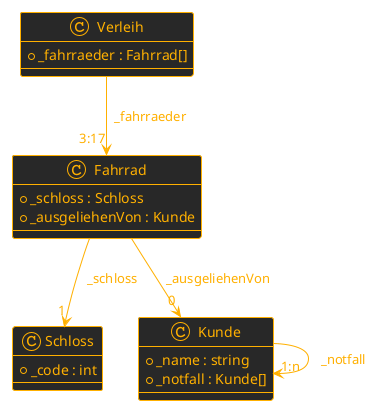

**Zettelübung: hat-Beziehungen und Multiplizitäten im Klassendiagramm 📐** (10 Minuten)

**Name:** 
Musterlösung 
**Datum:** 
_ _ _ _ _ _ _ _ _ _ _ _ 

## Übung 1: Was bedeutet die Multiplizität?

| am Pfeilende | bedeutet | im Code z. B. |
| :--- | :--- | :--- |
| ``1`` | **genau ein** Objekt | ein ``Feld``: ``Schloss _schloss`` |
| ``0`` | **keines oder eines** (die Beziehung darf fehlen) | ein ``Feld``, das auch leer sein darf: ``Kunde _ausgeliehenVon`` |
| ``0:n`` | **beliebig viele** (auch keines) | ein Array, das auch leer sein darf |
| ``1:n`` | **mindestens eines**, beliebig viele | ein Array mit mindestens einem Element: ``Kunde[] _notfall`` |
| ``3:17`` | **mindestens 3, höchstens 17** Objekte | ein Array mit 3 bis 17 Elementen: ``Fahrrad[] _fahrraeder`` |

>Tipp: Eine **einzelne Zahl** steht für eine einzelne Beziehung: ``1`` = genau eines, ``0`` = keines oder eines. Bei **vielen** schreiben wir **Minimum:Maximum** – links vom ``:`` das Minimum, rechts das Maximum. ``n`` heißt „beliebig viele“.

## Übung 2: Ergänze das Klassendiagramm



| von | nach | ``Feld`` | Multiplizität |
| :--- | :--- | :--- | :--- |
| ``Verleih`` | ``Fahrrad`` | ``_fahrraeder`` | ``3:17`` |
| ``Fahrrad`` | ``Schloss`` | ``_schloss`` | ``1`` |
| ``Fahrrad`` | ``Kunde`` | ``_ausgeliehenVon`` | ``0`` |
| ``Kunde`` | ``Kunde`` | ``_notfall`` | ``1:n`` |

## Übung 3: Kurz gefragt

#### 1. - Richtung
**Unidirektional.** Nur ``Fahrrad`` hat ein ``Feld`` vom ``Typ`` ``Kunde`` (``_ausgeliehenVon``). ``Kunde`` hat kein ``Feld`` vom ``Typ`` ``Fahrrad``. Im Klassendiagramm gibt es nur **einen** Pfeil mit **einer** Spitze: von ``Fahrrad`` zu ``Kunde``.

#### 2. - rekursiv
``_notfall`` in ``Kunde``: Der ``Typ`` des ``Feldes`` ist ``Kunde`` – die eigene ``Klasse``. Der Pfeil zeigt von ``Kunde`` zurück zu ``Kunde``. Gemeint sind trotzdem **andere** Kunden-Objekte.

#### 3. - bidirektional machen
```
Klasse: Kunde   Feld: _faehrt : Fahrrad   Multiplizität: 0
```
Jetzt gibt es Pfeile in **beide** Richtungen zwischen ``Fahrrad`` und ``Kunde`` → **bidirektional**.
