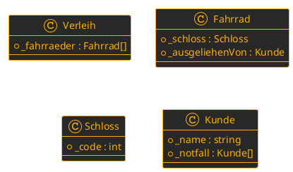

**Zettelübung: hat-Beziehungen und Multiplizitäten im Klassendiagramm 📐** (10 Minuten)

**Name:** 
_ _ _ _ _ _ _ _ _ _ _ _ _ _ _ _ _ _ _ _ _ _ _ _ _ _ _ 
**Datum:** 
_ _ _ _ _ _ _ _ _ _ _ _ 

## Übung 1: Was bedeutet die Multiplizität?

Ergänze die Tabelle.

<table style="width:100%; border-collapse:collapse; table-layout:fixed;">
<tr>
<th style="width:25%; border:1px solid; padding:6px;">am Pfeilende</th>
<th style="width:45%; border:1px solid; padding:6px;">bedeutet</th>
<th style="width:30%; border:1px solid; padding:6px;">im Code z. B.</th>
</tr>
<tr><td style="height:2.6em; border:1px solid; padding:6px;"><code>1:1</code></td><td style="border:1px solid;"></td><td style="border:1px solid;"></td></tr>
<tr><td style="height:2.6em; border:1px solid; padding:6px;"><code>0:1</code></td><td style="border:1px solid;"></td><td style="border:1px solid;"></td></tr>
<tr><td style="height:2.6em; border:1px solid; padding:6px;"><code>0:n</code></td><td style="border:1px solid;"></td><td style="border:1px solid;"></td></tr>
<tr><td style="height:2.6em; border:1px solid; padding:6px;"><code>1:n</code></td><td style="border:1px solid;"></td><td style="border:1px solid;"></td></tr>
<tr><td style="height:2.6em; border:1px solid; padding:6px;"><code>2:2</code></td><td style="border:1px solid;"></td><td style="border:1px solid;"></td></tr>
</table>

## Übung 2: Ergänze das Klassendiagramm

**Unsere Welt: ein Fahrradverleih**

Ein ``Verleih`` hat **viele** Fahrräder – mindestens eines, sonst wäre es kein Verleih. Jedes ``Fahrrad`` hat **genau ein** Schloss. Ein ``Fahrrad`` kann **höchstens einen** Kunden haben, der es gerade ausgeliehen hat – oder keinen. Jeder ``Kunde`` hat **genau zwei** Notfallkontakte, und jeder Notfallkontakt ist selbst wieder ein ``Kunde``. Das Fahrrad weiß, wer es ausgeliehen hat – der Kunde merkt sich das nicht.

Die vier ``Klassen`` sind schon gezeichnet. Zeichne alle **hat-Beziehungen** aus dem Text als **Pfeile** ein. Schreib an jeden Pfeil den ``Feld``-Namen und die **Multiplizität**.



## Übung 3: Kurz gefragt

#### 1. - Richtung
Ist die Beziehung zwischen ``Fahrrad`` und ``Kunde`` **unidirektional** oder **bidirektional**? Woran erkennst du es im Klassendiagramm?
```
___________________________________________________________

___________________________________________________________
```

#### 2. - rekursiv
Welche Beziehung ist **rekursiv**? Warum?
```
___________________________________________________________
```

#### 3. - bidirektional machen
Der Kunde soll sich ab jetzt merken, welches Fahrrad er gerade fährt (höchstens eines). Welches ``Feld`` bekommt welche ``Klasse``? Welche Multiplizität steht am neuen Pfeil?
```
Klasse: ______________   Feld: _________________________   Multiplizität: ______
```
