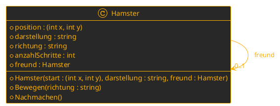

#### Welche Begriffe werden hier verwendet?
[``Klasse``](../../../05_Glossar.md#klasse), [``Objekt``](../../../05_Glossar.md#objekt), [``Instanz``](../../../05_Glossar.md#instanz), [``Instanziierung``](../../../05_Glossar.md#instanziierung), [``Zustand``](../../../05_Glossar.md#zustand), [``Verhalten``](../../../05_Glossar.md#verhalten), [``Mitglied``](../../../05_Glossar.md#mitglied), [``Feld``](../../../05_Glossar.md#feld), [``Methode``](../../../05_Glossar.md#methode), [``Konstruktor``](../../../05_Glossar.md#konstruktor), [``Schlüsselwort``](../../../05_Glossar.md#schlüsselwort), [``Typ``](../../../05_Glossar.md#typ), [``Variable``](../../../05_Glossar.md#variable), [``Referenz``](../../../05_Glossar.md#referenz), [``Assoziation``](../../../05_Glossar.md#assoziation), [``Klassendiagramm``](../../../05_Glossar.md#klassendiagramm), [``Objektdiagramm``](../../../05_Glossar.md#objektdiagramm), [``Domäne``](../../../05_Glossar.md#domäne), [``Aufruf``](../../../05_Glossar.md#aufruf), [``Parameter``](../../../05_Glossar.md#parameter).

# Klassen und Objekte 🐹🐭
Animierte Folien dazu: [L05.1_KlassenUndObjekte.html](L05.1_KlassenUndObjekte.html) · LiveCoding: [../../LiveCoding/L05Hamster](../../LiveCoding/L05Hamster/Program.cs)

Bis jetzt haben wir mit **fertigen** ``Typen`` gearbeitet: ``int``, ``string``, ``string[,]``, ``Random``. Ab jetzt bauen wir uns **eigene** ``Typen``. Diese nennen wir ``Klassen``.

## 1. Welche Teile hat ein Programm?
Wir schauen uns ein Hamster-Programm an: Ein Hamster 🐹 läuft rauf, rauf, runter, runter, rechts, links. Ein zweiter Hamster 🐭 macht **jeden Schritt nach**.

Wenn wir beschreiben, was wir sehen, sortieren wir die Begriffe in drei Kisten:

| Kiste | Frage | Begriffe aus dem Hamster-Programm |
|---|---|---|
| **Dinge in meiner Welt** | Was gibt es? | Hamster |
| **Zustand** | Was **hat** ein Ding? | Position, Darstellung, Richtung, Anzahl Schritte, Freund |
| **Verhalten** | Was **kann** ein Ding? | bewegen, nachmachen |

Die Objektorientierung gibt den Kisten **Fachbegriffe**:

| Alltag | Fachbegriff | im Code |
|---|---|---|
| Dinge in meiner Welt | ``Objekte`` | *paul*, *willi* |
| Zustand | ``Felder`` | ``position``, ``darstellung``, ``richtung``, ``anzahlSchritte``, ``freund`` |
| Verhalten | ``Methoden`` | ``Bewegen(richtung)``, ``Nachmachen()`` – und der ``Konstruktor`` ``Hamster(start, darstellung, freund)`` |

Welche ``Felder`` und ``Methoden`` ein Hamster haben darf, gibt eine **``Klasse``** vor – der Bauplan ``Hamster``. Das ``Feld`` ``freund`` ist besonders: Es ist selbst wieder ein Hamster. Das nennen wir **hat-Beziehung**.

>**Wir merken uns:**
>1. Ein Programm besteht aus ``Objekten`` (Dinge in meiner Welt). Ein ``Objekt`` hat einen ``Zustand`` (was es **hat**) und ein ``Verhalten`` (was es **kann**).
>2. Den ``Zustand`` setzen wir mit ``Feldern`` um, das ``Verhalten`` mit ``Methoden``.

## 2. Objekt vs. Klasse
Ein ``Objekt`` ist ein konkretes *Individuum* im Arbeitsspeicher. *paul* läuft im Kreis – seine Box zeigt seinen **aktuellen** ``Zustand`` (die Werte seiner ``Felder``) und seine ``Methoden``, die er aufrufen kann:

```
+-------------------------------+
| paul : Hamster                |
| position       = (2, 0)       |
| richtung       = "O"          |
| darstellung    = "🐹"         |
| anzahlSchritte = 2            |
| freund         = null         |
| + Bewegen(richtung)           |
| + Nachmachen()                |
+-------------------------------+
```

Kommt *willi* dazu, hat er seine **eigene** Box mit **eigenen** Werten. Die ``Methoden`` heißen gleich – aber sie laufen nur, wenn **willi** sich bewegt.

**Ohne Bauplan** könnte sich jeder Hamster eigene ``Felder`` und ``Methoden`` ausdenken: *willi* hätte plötzlich ein Feld ``groesse = 2`` und eine Methode ``Drehen()`` – und kein Programm wüsste mehr, was ein Hamster eigentlich kann. Darum gibt es die ``Klasse``: Sie **schränkt ein**, was die ``Objekte`` dürfen. **Alle** Hamster haben die **gleichen** ``Mitglieder`` – verschieden sind nur ihr ``Zustand`` und welche ``Methoden`` gerade **aufgerufen** werden.

| | **Objekt** | **Klasse** |
|---|---|---|
| Sticker | aktueller Zustand und Verhalten eines Individuums | vereinheitlicht die möglichen Zustände und Verhalten eines Objektes |
| auch genannt | ``Instanz`` der ``Klasse`` | Bauplan aller ``Objekte`` |
| Wie oft? | **beliebig oft** zur Laufzeit | **einmal** im Code |
| Beispiel | ``new Hamster((0, 0), "🐹", null)`` | ``class Hamster { ... }`` |

>**Wir merken uns:**
>3. Ein ``Objekt`` ist der aktuelle ``Zustand`` und das ``Verhalten`` eines Individuums – eine ``Instanz`` der ``Klasse``.
>4. Eine ``Klasse`` vereinheitlicht die möglichen ``Zustände`` und ``Verhalten`` eines ``Objektes`` – der Bauplan aller ``Objekte``.
>5. Alle ``Objekte`` einer ``Klasse`` haben die **gleichen** ``Mitglieder``. Verschieden sind ihr ``Zustand`` und ihre ``Aufrufe``.

## 3. Was ist eine Klasse?
Eine ``Klasse`` ist der **Bauplan** für ``Objekte``. Denk an einen Eintrag *Hamster* in einem Biologiebuch: Dort steht, *dass* ein Hamster eine Position hat und laufen kann. Das Buch selbst läuft aber nicht herum – es **beschreibt** nur.

Ein zweites Bild: Der **Keksausstecher** ist die ``Klasse``, die **Kekse** sind die ``Objekte``. Mit einem Ausstecher machen wir beliebig viele Kekse, und jeder Keks ist ein eigener.

Eine ``Klasse`` ist ein **selbst gebauter** ``Typ``:

| ``Typ`` / ``Klasse`` | ``Variable`` | ``Wert`` / ``Objekt`` |
|---|---|---|
| ``int`` | ``zahl`` | ``5`` |
| ``string`` | ``text`` | ``"Hallo"`` |
| ``Hamster`` | ``paul`` | ``new Hamster((0, 0), "🐹", null)`` |

>**Wir merken uns:**
>6. Eine ``Klasse`` ist ein **selbst gebauter** ``Typ``.

## 4. Die Mitglieder einer Klasse
Alles, was in den geschwungenen Klammern einer ``Klasse`` steht, nennen wir ``Mitglieder``. Jede ``Klasse`` bekommt ihr **eigenes File**: ``Hamster.cs``.

```csharp
class Hamster
{
    // 1) Felder: der Zustand
    public (int x, int y) position;
    public string darstellung;
    public string richtung;
    public int anzahlSchritte;
    public Hamster freund;          // hat-Beziehung

    // 2) Konstruktor: der Startzustand
    public Hamster((int x, int y) start, string darstellung, Hamster freund)
    {
        position = start;
        this.darstellung = darstellung;
        this.freund = freund;
    }

    // 3) Methoden: das Verhalten
    public void Bewegen(string richtung)
    {
        this.richtung = richtung;
        anzahlSchritte++;
        Console.WriteLine($"{darstellung} Schritt {anzahlSchritte}: geht nach {richtung}");
    }

    public void Nachmachen()
    {
        Bewegen(freund.richtung);
    }
}
```

| ``Mitglied`` | Aufgabe | Erkennungsmerkmal |
|---|---|---|
| ``Feld`` | speichert den ``Zustand`` **jedes** ``Objekts`` | ``Typ`` + Name, wie eine ``Variable`` |
| ``Konstruktor`` | legt den **Startzustand** fest, läuft bei ``new`` | heißt **genau wie die Klasse**, **kein** Rückgabetyp |
| ``Methode`` | beschreibt das ``Verhalten`` | wie eine ``Funktion`` – nur **in** der ``Klasse`` |

* ``(int x, int y)`` ist ein **Tupel**: zwei Werte in einem. Wir lesen sie mit ``position.x`` und ``position.y``.
* ``darstellung`` bestimmt, wie der Hamster in der Ausgabe aussieht (🐹, 🐭) – so sehen wir, **welcher** Hamster gerade etwas tut.
* ``anzahlSchritte`` zählt mit. So können wir die Ausgabe leichter nachvollziehen.
* Der ``Konstruktor`` bekommt **alle Infos** für den Start. Von außen setzen wir danach **keine** ``Felder`` mehr.
* ``this.darstellung`` bedeutet: **das** ``Feld`` ``darstellung`` dieses ``Objekts`` – nicht der gleichnamige ``Parameter``.
* ``public`` erlaubt den Zugriff von außen. Wann wir ``Felder`` verstecken (``private``), lernen wir bei der *Datenkapselung*.

>**Wir merken uns:**
>7. ``Felder``, ``Konstruktoren`` und ``Methoden`` sind ``Mitglieder`` einer ``Klasse``.
>8. Der ``Konstruktor`` heißt wie die ``Klasse``, hat **keinen** Rückgabetyp und bekommt alle Infos für den Startzustand.

## 5. Objekte erzeugen mit ``new``
Den Vorgang „aus dem Bauplan ein Objekt bauen“ nennen wir ``Instanziierung``. Wir verwenden das ``Schlüsselwort`` ``new`` und rufen damit den ``Konstruktor`` auf:

```csharp
Hamster paul  = new Hamster((0, 0), "🐹", null);   // paul hat keinen Freund
Hamster willi = new Hamster((1, 0), "🐭", paul);   // startet direkt daneben, Freund: paul
```

Was passiert bei ``new Hamster((0, 0), "🐹", null)``?
1. Im Arbeitsspeicher wird Platz für **ein** neues Hamster-``Objekt`` geschaffen. Alle ``Felder`` haben einen Standardwert (``(0, 0)``, ``null``, ``0``).
2. Der ``Konstruktor`` läuft und setzt ``position``, ``darstellung`` und ``freund``.
3. Die ``Variable`` *paul* bekommt eine ``Referenz`` auf dieses ``Objekt`` (vgl. ``Referenztypen`` in L02).

Auf die ``Mitglieder`` eines ``Objekts`` greifen wir mit dem **Punkt** zu:
```csharp
paul.Bewegen("N");                          // 🐹 Schritt 1: geht nach N
Console.WriteLine(paul.anzahlSchritte);     // 1
Console.WriteLine(willi.anzahlSchritte);    // 0 - willi hat sich nicht bewegt!
```
Jedes ``Objekt`` hat **eigene** ``Felder``. Ändert sich *paul*, bleibt *willi* unverändert.

>**Wir merken uns:**
>9. Ein ``Objekt`` entsteht durch ``Instanziierung``: ``new`` + Aufruf des ``Konstruktors``.
>10. Mit dem **Punkt** greifen wir auf ``Felder`` und ``Methoden`` eines ``Objekts`` zu: ``paul.anzahlSchritte``, ``paul.Bewegen("N")``.
>11. Jedes ``Objekt`` hat seine **eigenen** ``Felder``.

## 6. Die hat-Beziehung: ein Hamster hat einen Freund
*willi* soll *paul* nachmachen. Dafür muss *willi* seinen Freund **kennen**. Das erreichen wir mit einem ``Feld``, dessen ``Typ`` selbst eine ``Klasse`` ist – und geben den Freund schon beim Erzeugen mit:

```csharp
public Hamster freund;                              // in der Klasse

Hamster willi = new Hamster((1, 0), "🐭", paul);    // willi kennt jetzt paul
```

Diese Verbindung zwischen ``Objekten`` nennen wir ``Assoziation`` oder **hat-Beziehung**. Wir lesen: „*willi* **hat** einen Freund *paul*“. Umgekehrt kennt *paul* *willi* **nicht** (*paul* bekam ``null``) – die Beziehung geht nur in **eine** Richtung.

Über die Beziehung kann *willi* die ``Mitglieder`` seines Freundes verwenden:
```csharp
public void Nachmachen()
{
    Bewegen(freund.richtung);   // Richtung des Freundes lesen, selbst bewegen
}
```
*willi* muss nicht wissen, **warum** *paul* so gegangen ist – er fragt nur nach dem Ergebnis und erledigt den Rest selbst mit seiner eigenen ``Methode`` ``Bewegen``.

>**Wir merken uns:**
>12. Eine **hat-Beziehung** (``Assoziation``) setzen wir mit einem ``Feld`` um, dessen ``Typ`` eine ``Klasse`` ist.
>13. Über die hat-Beziehung kann ein ``Objekt`` die ``Mitglieder`` eines anderen ``Objekts`` verwenden: ``freund.richtung``.
>14. Ein ``Feld`` mit einem Klassen-``Typ`` ist ``null``, solange ihm kein ``Objekt`` zugewiesen wurde.

## 7. Klassendiagramm und Objektdiagramm
**Klassendiagramm** – die Sicht des **Bauplans** (gilt für **alle** Hamster):

* oben der Name, in der Mitte die ``Felder``, unten ``Konstruktor`` und ``Methoden``
* ``+`` steht für ``public``
* der Pfeil zeigt die hat-Beziehung: ein Hamster **kann** einen Freund haben

**Objektdiagramm** – eine **Momentaufnahme** zur Laufzeit (nach dem ersten Schritt):
```
+-------------------------+   freund   +-------------------------+
| willi : Hamster         |----------->| paul : Hamster          |
| position = (1, 0)       |            | position = (0, 0)       |
| darstellung = "🐭"      |            | darstellung = "🐹"      |
| richtung = "N"          |            | richtung = "N"          |
| anzahlSchritte = 1      |            | anzahlSchritte = 1      |
+-------------------------+            | freund = null           |
                                       +-------------------------+
```
* ``name : Klasse`` – welches ``Objekt`` von welcher ``Klasse``
* keine ``Methoden`` – die stehen im Bauplan

>**Wir merken uns:**
>15. Ein ``Klassendiagramm`` zeigt den Bauplan: ``Klassen``, ihre ``Mitglieder`` und ihre Beziehungen.
>16. Ein ``Objektdiagramm`` zeigt eine Momentaufnahme: konkrete ``Objekte`` mit konkreten ``Werten``.

## 8. Alles zusammen: paul geht, willi macht nach
``Program.cs``:
```csharp
string[] richtungen = { "N", "O", "S", "W" };
Random generator = new Random();

Hamster paul  = new Hamster((0, 0), "🐹", null);
Hamster willi = new Hamster((1, 0), "🐭", paul);

while (true)
{
    paul.Bewegen(richtungen[generator.Next(0, richtungen.Length)]);  // zufaellig
    willi.Nachmachen();                                                // folgen
    Console.WriteLine();
    Thread.Sleep(1000);                                                // 1 Sekunde warten
}
```
Mögliche Ausgabe:
```
🐹 Schritt 1: geht nach O
🐭 Schritt 1: geht nach O

🐹 Schritt 2: geht nach N
🐭 Schritt 2: geht nach N
```
>Die ``position`` ändert sich noch nicht – ``Bewegen`` merkt sich nur die Richtung. Die echte Bewegung auf einer Wiese (``string[,]``) ist die Zusatzaufgabe.

## 9. Typische Fehler
```csharp
// ❌ Fehler 1: Klasse statt Objekt verwenden
Hamster.Bewegen("N");          // Welcher Hamster? Der Bauplan kann nicht laufen!
// ✅
paul.Bewegen("N");

// ❌ Fehler 2: new vergessen
Hamster paul;
paul.Bewegen("N");             // Compilerfehler: paul hat noch kein Objekt

// ❌ Fehler 3: Nachmachen ohne Freund
Hamster paul = new Hamster((0, 0), "🐹", null);
paul.Nachmachen();             // NullReferenceException: freund ist null
// ✅ nur wer einen Freund mitbekommen hat, macht nach
Hamster willi = new Hamster((1, 0), "🐭", paul);
willi.Nachmachen();

// ❌ Fehler 4: Konstruktor mit Rueckgabetyp
public void Hamster((int x, int y) start, string darstellung, Hamster freund) { ... }   // Methode, kein Konstruktor!
```

## 10. Zusatzaufgaben ⭐
* ⭐ ``Bewegen`` konkret implementieren: Je nach Richtung (``"N"``, ``"O"``, ``"S"``, ``"W"``) ändert sich ``position.x`` bzw. ``position.y`` um 1.
* ⭐⭐ Eine Wiese als ``string[,]`` (z. B. 10 × 10, 🟩) anlegen und beide Hamster nach jedem Schritt mit ihrer ``darstellung`` zeichnen.
* ⭐⭐ Rand prüfen: Ein Hamster darf die Wiese nicht verlassen (Guard Clause, L02).
* ⭐⭐⭐ Alle weiteren ``Methoden`` konkret implementieren: ``Ausgeben()``, ``Zeichnen(string[,] wiese)`` – mit 2D-Array, Schleifen und co.

Weiter: [Wir merken uns](L05-WirMerkenUns.md) · [Zettelübung 1](../ZettelUebungen/01_BegriffeZuordnen.md) · [Zettelübung 2](../ZettelUebungen/02_KlassenUndObjekte.md)
