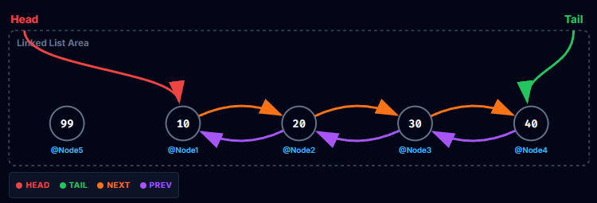

**Schriftliche Mitarbeitsüberprüfung - Referenztypen, Werttypen und Linked Lists**
PoS - CAMM - 3CHIF - Gruppe A

**Name:** 
_ _ _ _ _ _ _ _ _ _ _ _ _ _ _ _ _ _ _ _ _ _ _ _ _ _ _ 
**Datum:** 
12.10.2026

## Aufgabe 1 - **Konzepte**
1. Welche *vier* *Eigenschaften* haben ``Variablen``? Wie verändern sich diese *Eigenschaften*, wenn wir ``Variablen`` mit ``Referenztypen`` und ``Werttypen`` vergleichen?
$\\$
$\\$
$\\$
$\\$
$\\$

Ein ``Call-Stack`` kann mehrere ``Stackframes`` besitzen. Was passiert mit ``Variablen`` in einem ``Stackframe``, wenn dieser ``Stackframe`` nicht an der obersten Stelle ist?
$\\$
$\\$
$\\$
$\\$
$\\$

## Aufgabe 2 - **Code Ausschnitt**
* Vervollständige die folgende bereits aufgerufene ``Funktion`` einer ``Double Linked List``.

```csharp
public void AddFirst(int value){
    ________________ = ______________________________;
    if (              ) {
        
        


    } else {
       
       


    }
}
```

