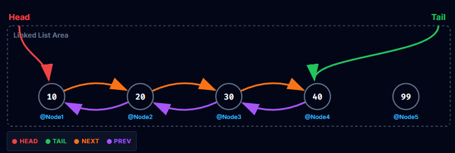

**Schriftliche Mitarbeitsüberprüfung - Referenztypen, Werttypen und Linked Lists**
PoS - CAMM - 3CHIF - Gruppe B

**Name:** 
_ _ _ _ _ _ _ _ _ _ _ _ _ _ _ _ _ _ _ _ _ _ _ _ _ _ _ 
**Datum:** 
12.10.2026

## Aufgabe 1 - **Konzepte**
1. In welche *zwei* für uns relevanten Bereiche wird der ``Arbeitsspeicher`` unterschieden? Beschreibe diese kurz.
$\\$
$\\$
$\\$
$\\$
$\\$

2. Was ist der Unterschied zwischen ``Referenztypen`` und ``Werttypen``? Wohin zeigt die ``Referenz`` ``null``?
$\\$
$\\$
$\\$
$\\$
$\\$

## Aufgabe 2 - **Code Ausschnitt**
* Vervollständige die folgende bereits aufgerufene ``Funktion`` einer ``Double Linked List``.

```csharp
public void AddLast(int value){
    ________________ = ______________________________;
    if (              ) {
        
        


    } else {
       
       


    }
}
```

