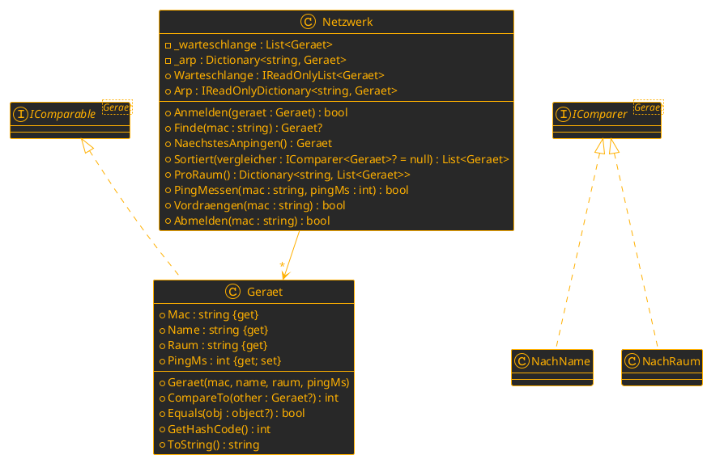

# Aufgabe: Das Schulnetzwerk 🌐 – List, Dictionary und Interfaces
Programmierübung am PC · Arbeitszeit ca. 60–70 Minuten · Lösung im Ordner ``Loesung``

Welche ``Konzepte`` üben wir hier?
- **Neu aus L03:**
  - ``List<T>``: CRUD mit ``Add``, ``Insert``, Index, ``Remove``, ``RemoveAt``
  - ``Dictionary<TKey, TValue>``: CRUD mit ``TryAdd``, ``TryGetValue``, Indexer, ``Remove``
  - ein ``Dictionary`` mit ``List<T>`` als Value
  - ``IComparable<T>`` (die **eine** natürliche Sortierung) und ``IComparer<T>`` (beliebig viele weitere)
  - ``Equals`` und ``GetHashCode`` überschreiben – passend zueinander
  - ``IReadOnlyList<T>`` und ``IReadOnlyDictionary<TKey, TValue>`` als Rückgabetypen (Datenkapselung über Interfaces)
- **Wiederholung:** Properties, Referenzen (zwei Datenstrukturen zeigen auf **dieselben** Objekte), Guard Clauses

Welche ``Denkweise`` üben wir hier?
- Wann **Liste** (Reihenfolge, Position), wann **Dictionary** (nachschlagen über einen Schlüssel)?
- Was ist ein guter **Key**? Etwas Eindeutiges, das sich **nie** ändert.
- Was ist **gleich**? Zwei ``Geraet``-Objekte mit derselben MAC-Adresse sind **dasselbe Gerät** – auch wenn ihr Ping verschieden ist.

Hilfe: [Folien Liste oder Dictionary?](../Skripten/L03.1_ListVsDictionary.html) – vor allem die Tabs *Dictionary* und *Was darf ein Key sein?*

## Die Geschichte
Ein Rechner, der ein Gerät im Schulnetz erreichen will, braucht dessen **MAC-Adresse**. Er schlägt sie in seiner **ARP-Tabelle** nach – das ist genau ein Dictionary. (Schau dir deine eigene an: ``arp -a`` in der Konsole.)

Unser ``Netzwerk`` verwaltet seine Geräte in **zwei** Datenstrukturen:

| Struktur | Typ | wofür |
|---|---|---|
| Warteschlange | ``List<Geraet>`` | Reihenfolge, in der die Geräte angepingt werden. Wichtige Geräte (Router) dürfen nach vorne. |
| ARP-Tabelle | ``Dictionary<string, Geraet>`` | MAC → Gerät, schnell nachschlagen, ohne alle Geräte durchzugehen |

Beide speichern **Referenzen** auf dieselben ``Geraet``-Objekte.

## So arbeitest du
* Kopiere die ``.cs``-Dateien aus ``Vorlage`` in ein neues Projekt ``Schulnetzwerk``.
* Properties, ``ToString`` und die **Köpfe** aller ``Methoden`` sind fertig. Du schreibst nur die Inhalte – überall, wo ``// TODO`` steht.
* ``Program.cs`` ist **fertig** und testet von Anfang an **alle** Methoden. Starte nach jedem Teil und vergleiche mit dem **erwarteten Output**. Am Anfang steht überall ``False``, ``0`` oder nichts – mit jedem Teil stimmt mehr.

### Klassendiagramm


---

### Teil 1 - level: 🙂 - ``Geraet``: vergleichen und gleich sein - ~10 min
1. **Konstruktor:** alle vier Properties setzen.
2. **``CompareTo``** (``IComparable<Geraet>``): das **schnellste** Gerät zuerst (kleinerer ``PingMs``). Bei gleichem Ping entscheidet der ``Name``. Ist ``other`` ``null``, liefere ``1``.
   >Ergebnis < 0: ich komme vorher · 0: gleich · > 0: ich komme nachher. ``int`` und ``string`` haben selbst schon ``CompareTo``.
3. **``Equals``**: zwei Geräte sind gleich, wenn sie dieselbe ``Mac`` haben – **nur** die MAC zählt.
4. **``GetHashCode``**: muss zu ``Equals`` passen → ``return Mac.GetHashCode();``
   >Gleiche Objekte (laut ``Equals``) **müssen** den gleichen Hash haben, sonst landen sie in einem Dictionary in verschiedenen Fächern. Vergleicht ``Equals`` **mehrere** Properties, kombiniert man sie mit ``HashCode.Combine(a, b)``.

**Fragen:**
1. Warum darf ``PingMs`` **nicht** in ``Equals`` und ``GetHashCode`` vorkommen?
2. ``laptop`` und ``kopie`` haben verschiedene Pings. Warum ist ``laptop.Equals(kopie)`` trotzdem ``True``?

Erwarteter Output:
```
--- Teil 1: Geraet ---
Laptop   B2:02 E12      95 ms
True
True
True
True
False
```

### Teil 2 - level: 🙂 - Warteschlange (List CRUD) - ~15 min
1. **``Anmelden``**: Ist die MAC schon in der ARP-Tabelle → ``false``. Sonst in die ARP-Tabelle **und** hinten in die Warteschlange eintragen → ``true``.
   >``_arp.TryAdd(key, value)`` liefert ``false``, wenn der Key schon da ist – Prüfen und Einfügen in einem Schritt.
2. **``NaechstesAnpingen``** (Round Robin): Ist die Warteschlange leer → ``InvalidOperationException``. Sonst das **erste** Gerät vorne entfernen, **hinten** wieder anhängen und zurückgeben.
3. **``Vordraengen``**: Gerät über die MAC finden (verwende ``Finde`` aus Teil 3 – oder schreibe es gleich jetzt), aus der Warteschlange entfernen und mit ``Insert(0, …)`` vorne einfügen. Unbekannte MAC → ``false``.

Erwarteter Output (``Vordraengen`` erst, wenn ``Finde`` fertig ist):
```
--- Teil 2: Warteschlange ---
True
True
True
True
True
False
5 Geräte
angepingt: Drucker
angepingt: Laptop
True
False
  Router   00:01 Keller  110 ms
  Beamer   C3:33 E14     140 ms
  Switch   D4:08 E14      95 ms
  Drucker  A1:17 E12     120 ms
  Laptop   B2:02 E12      95 ms
```

### Teil 3 - level: 🤔 - ARP-Tabelle (Dictionary CRUD) - ~15 min
1. **``Finde``**: über ``TryGetValue`` nachschlagen. Unbekannte MAC → ``null``.
2. **``PingMessen``**: Gerät finden und ``PingMs`` setzen → ``true``. Unbekannt → ``false``.
3. **``Abmelden``**: aus der ARP-Tabelle **und** aus der Warteschlange entfernen. Unbekannt → ``false``.
   >``_arp.Remove(mac, out Geraet? geraet)`` entfernt und liefert gleichzeitig das entfernte Objekt.

**Fragen:**
3. ``PingMessen`` ändert das Gerät nur über die ARP-Tabelle. Warum zeigt danach auch ``Warteschlange[1]`` die neuen 80 ms?
4. ``Finde`` ist O(1). Wie lange würde ``Finde`` dauern, wenn es nur die Liste gäbe?
5. ``_warteschlange.Remove(geraet)`` verwendet ``Equals``. Was würde ``Remove(new Geraet("A1:17", "?", "?", 0))`` **vor** und **nach** Teil 1 liefern?

Erwarteter Output:
```
--- Teil 3: ARP-Tabelle ---
Beamer   C3:33 E14     140 ms
True
True
False
Beamer   C3:33 E14      80 ms
True
False
4 in ARP, 4 in der Warteschlange
```

### Teil 4 - level: 🤔 - Sortieren mit IComparable und IComparer - ~10 min
1. **``Sortiert``**: Erzeuge eine **Kopie** der Warteschlange (``new List<Geraet>(_warteschlange)``), sortiere sie mit ``Sort(vergleicher)`` und liefere sie zurück. Ist ``vergleicher`` ``null``, verwendet ``Sort`` automatisch ``CompareTo`` aus Teil 1.
2. **``NachName``** (``IComparer<Geraet>``): nach ``Name``.
3. **``NachRaum``**: zuerst nach ``Raum``, im selben Raum nach ``Name``.

**Fragen:**
6. Warum gibt es **zwei** Interfaces? Wann ``IComparable``, wann ``IComparer``?
7. Warum sortieren wir eine **Kopie**? Was würde ``Sort()`` direkt auf ``_warteschlange`` mit dem Round Robin machen?

Erwarteter Output:
```
--- Teil 4: Sortieren ---
nach Ping:
  Beamer   C3:33 E14      80 ms
  Laptop   B2:02 E12      95 ms
  Switch   D4:08 E14      95 ms
  Router   00:01 Keller  110 ms
nach Name:
  Beamer   C3:33 E14      80 ms
  Laptop   B2:02 E12      95 ms
  Router   00:01 Keller  110 ms
  Switch   D4:08 E14      95 ms
nach Raum:
  Laptop   B2:02 E12      95 ms
  Beamer   C3:33 E14      80 ms
  Switch   D4:08 E14      95 ms
  Router   00:01 Keller  110 ms
erstes in der Warteschlange: Router
```

### Teil 5 - level: 💀 - Ein Dictionary mit Listen - ~10 min
**``ProRaum``** liefert für jeden Raum die Liste seiner Geräte: ``Dictionary<string, List<Geraet>>``.
- Gehe die Warteschlange durch.
- Gibt es für den Raum noch **keine** Liste (``TryGetValue`` liefert ``false``), lege eine neue an und trage sie ein.
- Füge das Gerät der Liste hinzu.

**Frage:**
8. Du holst die Liste mit ``TryGetValue`` und machst ``liste.Add(…)``. Warum musst du die Liste danach **nicht** wieder ins Dictionary schreiben?

Erwarteter Output:
```
--- Teil 5: pro Raum ---
Keller: Router
E14: Beamer Switch
E12: Laptop
```

### Zusatzaufgaben ⭐
* ⭐ ``Langsamste(int anzahl)`` liefert die ``anzahl`` Geräte mit dem höchsten Ping. (Tipp: ``Sortiert()`` und ``Reverse()``.)
* ⭐⭐ Ersetze den Key ``string`` durch einen eigenen Typ ``record MacAdresse(string Wert);``. Was musst du am ``record`` **nicht** schreiben, was bei einer ``class`` nötig wäre?
* ⭐⭐ Mach aus ``Geraet`` testweise einen ``record`` mit ``PingMs { get; set; }``. Melde ein Gerät an und ändere danach den Ping. Was liefert jetzt ``Equals`` zwischen ``laptop`` und ``kopie``? Warum ist ``Geraet`` als ``class`` mit Equals über die MAC die bessere Wahl?
