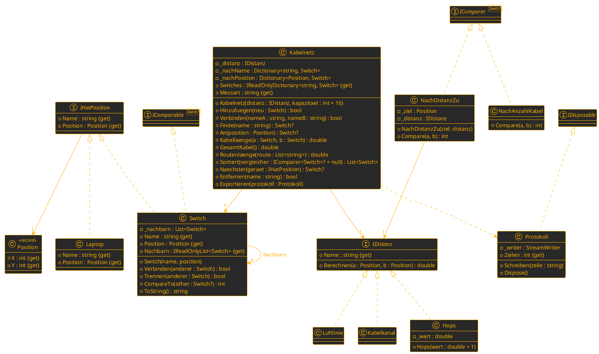

# Aufgabe: Das Kabelnetz 🔌 – List, Dictionary und Interfaces
Programmierübung am PC · Arbeitszeit ca. 90 Minuten · Lösung im Ordner ``Loesung``

Welche ``Konzepte`` üben wir hier?
- **List und Dictionary** (L03.1):
  - ``List<T>``: CRUD mit ``Add``, ``Remove``, ``Contains``, ``Sort``
  - ``Dictionary<TKey, TValue>``: CRUD mit ``ContainsKey``, ``Add``, ``TryGetValue``, ``Remove(key, out value)``
  - ein ``record`` als **Key** (Wertsemantik: eine *neue* ``Position`` mit gleichen Werten findet den Eintrag)
  - **Kapazität** im Konstruktor: ``new Dictionary<…>(kapazitaet)``
- **Interfaces** (L03.2):
  - **hat-Beziehung** im Vertrag: ``IHatPosition`` verlangt eine Property ``Position``
  - ``IComparable<T>`` (eine natürliche Ordnung) und ``IComparer<T>`` (beliebig viele, auch **mit Zustand**)
  - ``IDisposable`` + ``using``
  - **gegen ein Interface programmieren**, **Dependency Injection** und **Inversion of Control**: Das ``Kabelnetz`` weiß nicht, *wie* Distanzen gerechnet werden – es bekommt ein ``IDistanz`` von außen.
- **Wiederholung:** Properties, Referenzen, Guard Clauses, Default-Parameter

Hilfe: [Folien Liste oder Dictionary?](../Skripten/L03.1_ListVsDictionary.html) · [Folien Interfaces](../Skripten/L03.2_Interfaces.html)

## Die Geschichte
Die Schule bekommt ein neues Kabelnetz. Im Gebäudeplan (Koordinaten in Metern) stehen **Switches**, die mit Kabeln verbunden sind:

```
 y
 40 │              Ost ──────────── Bibliothek
    │            ╱  │
 20 │   West   ╱    │
    │    │   ╱      │
  0 │   Server ──── Labor
    └──────────────────────────────────────── x
         0         30              60
```
Kabel: Server–Ost, Server–West, Server–Labor, Labor–Ost, Ost–Bibliothek.

Wie lang ist ein Kabel? Das hängt davon ab, **wie** man misst:

| ``IDistanz`` | Idee | Server → Ost |
|---|---|---|
| ``Luftlinie`` | schräg durch den Raum (Pythagoras): √(dx² + dy²) | √(30² + 40²) = **50 m** |
| ``Kabelkanal`` | nur waagrecht und senkrecht entlang der Wände: \|dx\| + \|dy\| | 30 + 40 = **70 m** |
| ``Hops`` | jedes Kabel zählt gleich (Standard: 1) | **1** Sprung |

Das ``Kabelnetz`` bekommt die Messart über den **Konstruktor** – wie die ``Alarmanlage`` ihren ``ISensor``. Welche, entscheidet ``Program`` (Composition Root, Methode ``Aufbauen``).

## So arbeitest du
* Kopiere die ``.cs``-Dateien aus ``Vorlage`` in ein neues Projekt ``Kabelnetz``. Jede Klasse hat ihr eigenes File.
* Properties, Konstruktoren und die **Köpfe** aller Methoden sind fertig. Du schreibst nur die Inhalte – überall, wo ``// TODO`` steht.
* ``Program.cs`` ist **fertig** und testet von Anfang an **alle** Methoden. Starte nach jedem Teil und vergleiche mit dem **erwarteten Output**.
* Im erwarteten Output steht hinter ``←``, **welcher Aufruf** die Zeile erzeugt. Das steht nicht in deiner Konsole – es hilft dir, den Fehler zu finden.
* Die [Animation](Animated-Slides-Kabelnetz.html) spielt die Musterlösung Schritt für Schritt an genau diesen Daten durch.

### Klassendiagramm


---

### Teil 1 - level: 🙂 - Distanzen hinter einem Interface - ~10 min
1. **``Luftlinie.Berechnen``**: ``dx = b.X - a.X``, ``dy = b.Y - a.Y``, Ergebnis ``Math.Sqrt(dx * dx + dy * dy)``.
2. **``Kabelkanal.Berechnen``**: ``Math.Abs(dx) + Math.Abs(dy)``.
3. **``Hops.Berechnen``**: immer ``_wert`` (Standard 1 über den Default-Parameter).

**Fragen:**
1. Alle drei Klassen haben dieselbe Methode ``Berechnen``. Was gewinnen wir, wenn sie dasselbe **Interface** ``IDistanz`` umsetzen, statt einfach drei Klassen mit gleich benannter Methode zu sein?
2. ``ost == new Position(30, 40)`` liefert ``True``, obwohl es zwei verschiedene Objekte im Heap sind. Warum? Was käme heraus, wenn ``Position`` eine ``class`` wäre?

Erwarteter Output:
```
--- Teil 1: Distanzen ---
Luftlinie: 50,0 m           ← luft.Berechnen(server, ost)
Kabelkanal: 70,0 m          ← kanal.Berechnen(server, ost)
Hops: 1,0                   ← hops.Berechnen(server, ost)
True                        ← ost == new Position(30, 40)
```

### Teil 2 - level: 🙂 - Switch und Kabel (List) - ~15 min
1. **``Verbinden``**: Ist ``anderer`` der Switch selbst (``anderer == this``) oder schon in ``_nachbarn`` → ``false``. Sonst **beide** Seiten eintragen: ``_nachbarn.Add(anderer)`` **und** ``anderer._nachbarn.Add(this)`` → ``true``.
   >Ein Kabel hat zwei Enden. ``_nachbarn`` ist ``private`` – trotzdem darf ``Switch`` auf ``anderer._nachbarn`` zugreifen, weil es dieselbe **Klasse** ist.
2. **``Trennen``**: aus **beiden** Listen entfernen. ``Remove`` liefert ``false``, wenn nichts entfernt wurde → dann ``false``.
3. **``CompareTo``**: ``other == null`` → ``1``, sonst ``string.Compare(Name, other.Name)``.

**Frage:**
3. ``Switch`` setzt **zwei** Interfaces um: ``IHatPosition`` und ``IComparable<Switch>``. ``IHatPosition`` verlangt eine **hat-Beziehung** – aber nur über eine Property. Warum kann ein Interface kein Feld ``private Position _position;`` vorschreiben? Wo steckt bei ``Switch`` die hat-Beziehung zu den Nachbarn wirklich?

Erwarteter Output:
```
--- Teil 2: Kabel ---
True                            ← s1.Verbinden(s2)
False                           ← s1.Verbinden(s2)   schon verbunden
False                           ← s1.Verbinden(s1)   mit sich selbst
1                               ← s2.Nachbarn.Count
True                            ← s1.CompareTo(s2) > 0
True                            ← s1.Trennen(s2)
False                           ← s1.Trennen(s3)   nie verbunden
Server     (  0|  0)  0 Kabel   ← s1.ToString()
```

### Teil 3 - level: 🤔 - Das Kabelnetz (Dictionary CRUD) - ~15 min
Das ``Kabelnetz`` speichert jeden Switch in **zwei** Dictionaries: nach ``Name`` und nach ``Position``. Beide zeigen auf **dasselbe** Objekt.
1. **``Hinzufuegen``**: Ist der ``Name`` **oder** die ``Position`` schon vergeben (``ContainsKey``) → ``false``. Sonst in **beide** Dictionaries eintragen → ``true``.
2. **``Finde``** und **``An``**: mit ``TryGetValue`` nachschlagen, unbekannt → ``null``.
3. **``Verbinden``**: beide Switches über ``Finde`` holen. Fehlt einer → ``false``. Sonst ``a.Verbinden(b)``.

**Fragen:**
4. ``netz.An(new Position(0, 20))`` findet „West“, obwohl wir ein **neues** Objekt als Key übergeben. Warum klappt das mit einem ``record``? Was müsstest du bei einer ``class Position`` zusätzlich schreiben?
5. Warum ist ``Switch`` selbst **kein** guter Key – und ``Position`` schon?
6. Der Konstruktor legt die Dictionaries mit ``kapazitaet`` an. Was spart das? Wie viele Fächer hätte ein Dictionary ohne Angabe nach 5 Einträgen?

Erwarteter Output:
```
--- Teil 3: Kabelnetz ---
5 Switches                      ← netz.Switches.Count
False                           ← netz.Hinzufuegen(new Switch("Ost", (99|99)))   Name vergeben
False                           ← netz.Hinzufuegen(new Switch("Neu", (30|40)))   Platz belegt
Labor      ( 30|  0)  2 Kabel   ← netz.Finde("Labor")
True                            ← netz.Finde("Keller") == null
West       (  0| 20)  1 Kabel   ← netz.An(new Position(0, 20))
False                           ← netz.Verbinden("Labor", "Keller")
True                            ← netz.Finde("Ost") == netz.An(new Position(30, 40))
```

### Teil 4 - level: 🤔 - Kabellängen mit austauschbarer Distanz (DI) - ~15 min
1. **``Kabellaenge``**: ``_distanz.Berechnen(a.Position, b.Position)``. Das ``Kabelnetz`` weiß **nicht**, welche Messart dahintersteckt.
2. **``GesamtKabel``**: Summe aller Kabel. Jedes Kabel steht in **zwei** Nachbarlisten – zähle es nur, wenn ``a.CompareTo(b) < 0``.
3. **``Routenlaenge``**: Gehe die Namen mit ``foreach`` durch und merke dir den **vorherigen** Switch (``Switch? vorher = null``).
   - Unbekannter Name → ``-1``
   - ``vorher`` und aktueller Switch nicht verbunden (``vorher.Nachbarn.Contains(...)``) → ``-1``
   - sonst ``Kabellaenge(vorher, aktuell)`` aufsummieren

**Fragen:**
7. ``Program`` ruft ``Aufbauen`` dreimal mit einer **anderen** ``IDistanz`` auf. Wie viele Zeilen im ``Kabelnetz`` musstest du dafür ändern? Was wäre, wenn im Konstruktor ``_distanz = new Luftlinie();`` stünde?
8. Mit ``Luftlinie`` ist der direkte Weg Server → Ost kürzer als der Umweg über das Labor, mit ``Kabelkanal`` gleich lang. Warum?
9. Wer hat hier die **Kontrolle** darüber, wie gemessen wird – ``Kabelnetz`` oder ``Program``? Wie nennt man dieses Prinzip, und wie heißt die Technik, mit der wir es umsetzen?

Erwarteter Output:
```
--- Teil 4: Kabellängen ---
Luftlinie  gesamt 170,0 · direkt 50,0 · Umweg 70,0 · kaputt -1   ← Aufbauen(new Luftlinie()):  GesamtKabel() · Routenlaenge(direkt / umweg / kaputt)
Kabelkanal gesamt 190,0 · direkt 70,0 · Umweg 70,0 · kaputt -1   ← Aufbauen(new Kabelkanal())
Hops       gesamt   5,0 · direkt  1,0 · Umweg  2,0 · kaputt -1   ← Aufbauen(new Hops())
```

### Teil 5 - level: 🤔 - Sortieren und der nächste Switch - ~15 min
1. **``Sortiert``**: die Kopie mit ``kopie.Sort(vergleicher)`` sortieren. Ist ``vergleicher`` ``null``, verwendet ``Sort`` automatisch ``CompareTo`` aus Teil 2.
2. **``NachAnzahlKabel``**: **mehr** Nachbarn zuerst (Achtung: absteigend → ``b`` mit ``a`` vergleichen), bei Gleichstand nach Name.
3. **``NachDistanzZu``**: Dieser Vergleicher hat **Zustand** – er merkt sich Ziel und Messart. Distanz von ``a`` und ``b`` zum Ziel berechnen und mit ``CompareTo`` vergleichen. Gleich weit → nach Name.
4. **``Naechster``**: ``Sortiert(new NachDistanzZu(geraet.Position, _distanz))`` und das erste Element liefern. Keine Switches → ``null``.

**Fragen:**
10. ``Naechster`` nimmt ein ``IHatPosition`` – nicht ein ``Laptop``. Welche Objekte kann man deshalb übergeben? Warum ist der nächste Switch zum Labor das Labor selbst?
11. Warum ist ``NachDistanzZu`` ein ``IComparer`` und kein ``CompareTo`` in ``Switch``?

Erwarteter Output:
```
--- Teil 5: Sortieren ---
nach Name:                                ← netz.Sortiert()
  Bibliothek ( 60| 40)  1 Kabel
  Labor      ( 30|  0)  2 Kabel
  Ost        ( 30| 40)  3 Kabel
  Server     (  0|  0)  3 Kabel
  West       (  0| 20)  1 Kabel
nach Anzahl Kabel:                        ← netz.Sortiert(new NachAnzahlKabel())
  Ost        ( 30| 40)  3 Kabel
  Server     (  0|  0)  3 Kabel
  Labor      ( 30|  0)  2 Kabel
  Bibliothek ( 60| 40)  1 Kabel
  West       (  0| 20)  1 Kabel
nach Distanz zu Laptop Anna:              ← netz.Sortiert(new NachDistanzZu(laptop.Position, new Luftlinie()))
  Ost        ( 30| 40)  3 Kabel
  West       (  0| 20)  1 Kabel
  Bibliothek ( 60| 40)  1 Kabel
  Labor      ( 30|  0)  2 Kabel
  Server     (  0|  0)  3 Kabel
nächster zu Laptop Anna: Ost              ← netz.Naechster(laptop)
nächster zu Labor: Labor                  ← netz.Naechster(netz.Finde("Labor"))
```

### Teil 6 - level: 💀 - Entfernen und Protokoll (IDisposable) - ~15 min
1. **``Entfernen``**: mit ``_nachName.Remove(name, out Switch? weg)`` entfernen (unbekannt → ``false``), dann ``_nachPosition.Remove(weg.Position)``. Zum Schluss **alle Kabel** von ``weg`` trennen.
   >``foreach`` über ``weg.Nachbarn`` und darin ``Trennen`` → **InvalidOperationException**: Die Liste ändert sich, während du sie durchgehst. Gehe darum über eine **Kopie**: ``new List<Switch>(weg.Nachbarn)``.
2. **``Protokoll.Schreiben``**: ``_writer.WriteLine(zeile)`` und ``Zeilen++``.
3. **``Protokoll.Dispose``**: ``_writer.Dispose()`` und ``"Protokoll geschlossen"`` ausgeben.
4. **``Exportieren``**: jeden Switch aus ``Sortiert()`` als Zeile schreiben, danach ``$"Gesamt: {GesamtKabel():0.0} m ({Messart})"``.

**Fragen:**
12. Solange ``Dispose`` leer ist, meldet ``Program`` „Datei ist noch gesperrt“. Warum? Was macht ``using`` – auch dann, wenn beim Exportieren eine Exception fliegt?
13. Nach ``Entfernen("Ost")`` hat das Labor nur noch ein Kabel. Was wäre ohne das Trennen passiert – in welcher Liste würde „Ost“ noch stehen?

Erwarteter Output:
```
--- Teil 6: Entfernen und Protokoll ---
True                                      ← netz.Entfernen("Ost")
False                                     ← netz.Entfernen("Ost")
True                                      ← netz.An(new Position(30, 40)) == null
Labor      ( 30|  0)  1 Kabel             ← netz.Finde("Labor")
Protokoll geöffnet                        ← new Protokoll("kabelnetz.txt")
5 Zeilen geschrieben                      ← protokoll.Zeilen
Protokoll geschlossen                     ← Dispose() am Ende von using
  Bibliothek ( 60| 40)  0 Kabel
  Labor      ( 30|  0)  1 Kabel
  Server     (  0|  0)  2 Kabel
  West       (  0| 20)  1 Kabel
  Gesamt: 50,0 m (Luftlinie)               ← File.ReadAllLines("kabelnetz.txt")
```

### Zusatzaufgaben ⭐
* ⭐ Schreibe eine vierte Messart ``Stockwerke : IDistanz``: Kabelkanal, aber jedes Kabel kostet zusätzlich ``aufschlag`` Meter (Default-Parameter, z. B. 5). Ändere nur ``Program`` – das ``Kabelnetz`` bleibt unverändert.
* ⭐⭐ ``Dictionary<int, List<Switch>> ProAnzahlKabel()``: Gruppiere die Switches nach ihrer Anzahl Kabel (wie ``ProRaum`` in Aufgabe 1).
* ⭐⭐ ``Naechster`` soll den Switch **selbst** überspringen, wenn ``geraet`` ein Switch ist. Tipp: ``if (geraet is Switch s && …)``.
* 💀 ``KuerzesteRoute(string von, string nach)``: Probiere alle Routen über **höchstens einen** Zwischen-Switch und liefere die kürzeste Länge.
