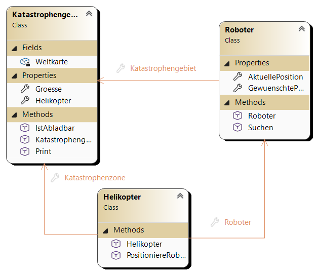

### Test 1

Sie können maximal 100 Punkte erreichen
Es sind zur Prüfung zugelassen:
    * Transparente Wasserflasche
    * Von mir ausgegebenes Papier und von Ihnen mitgebrachtes Schreibwerkzeug.

***Alles andere ist nicht zugelassen.***

* Viel Erfolg!

Notenschlüssel:
[0-50): N5; [50-62.5%): G4; [62.5-75%): B3; [75-87.5%): G2; [87.5-100%]: S1., 

---

#### Aufgabe 01 - Rettungseinsatz im Katastrophengebiet - 45%

In einem schwer zugänglichen Katastrophengebiet sollen autonome Suchroboter von Helikoptern abgesetzt werden, um nach Vermissten zu suchen. Da dichter Rauch über dem Gebiet hängt, haben die Helikopter keine direkte Sicht auf die gesamte Karte, sondern müssen bei der Einsatzzentrale des Katastrophengebiets anfragen, ob eine Landung an bestimmten Koordinaten gefahrlos möglich ist.

<center></center>

##### Allgemeine Rahmenbedingungen der Simulation
* **Kartengröße:** Das Katastrophengebiet ist quadratisch und muss **mindestens 15 × 15 Felder** groß sein (falls beim Erstellen ein kleinerer Wert übergeben wird, wird die Größe automatisch auf 15 gesetzt). Es darf aber auch größer sein.
* **Gelände-Aufteilung:**
  * Zu Beginn besteht das gesamte Gebiet aus festem Boden (Erde: 🟫).
  * **20 % der Gesamtfläche** sind tiefe Löcher (🕳️).
  * **30 % der Gesamtfläche** sind überflutete Wasserstellen (💧).
* **Anzahl der Einheiten:**
  * Es werden genau **10 % der Gesamtfläche** (abgerundet auf ganze Zahlen, bei 15 × 15 also 22 Stück) an Suchrobotern (🤖) und ebenso viele Helikopter (🚁) benötigt.
* **Schwerpunkt-Positionen (Hotspots):**
  * An drei bekannten Koordinaten im Format *(y, x)* werden besonders viele Vermisste vermutet: **(4, 6)**, **(2, 7)** und **(6, 9)**.
  * Die ersten drei Roboter erhalten genau diese drei Koordinaten als ihre gewünschte Zielposition. Alle weiteren Roboter wählen sich beim Start eine zufällige gewünschte Position innerhalb der Gebietsgrenzen.

##### Beschreibung der Klassen

##### 1. Klasse `Roboter`
* **Eigenschaften:**
  * **Katastrophengebiet:** Referenz auf das Katastrophengebiet, in dem der Roboter eingesetzt wird (nur innerhalb der Klasse setzbar).
  * **GewuenschtePosition:** Ein Tupel für Zeile und Spalte *(y, x)*, zu dem der Roboter ursprünglich hin möchte (nur innerhalb der Klasse setzbar).
  * **AktuellePosition:** Ein Tupel für Zeile und Spalte *(y, x)*, an dem der Roboter vom Helikopter tatsächlich abgeladen wurde (darf von außen durch den Helikopter gesetzt werden).
* **Konstruktor:**
  * Nimmt die Referenz auf das **Katastrophengebiet** sowie ein Tupel für die **gewünschte Position** entgegen und speichert beide Werte in den entsprechenden Eigenschaften. Dadurch ist sichergestellt, dass Helikopter und Roboter dasselbe Katastrophengebiet referenzieren.
* **Methoden:**
  * **Suchen:** Gibt keinen Wert zurück. Schreibt folgende Meldung in die Konsole:
    > *Beginne suche auf position (y, x) und bewege mich auf position (y, x)*
    *(wobei zuerst die aktuelle Position und danach die gewünschte Position ausgegeben wird).*

##### 2. Klasse `Helikopter`
* **Eigenschaften:**
  * **Katastrophenzone:** Referenz auf das Katastrophengebiet (nur innerhalb der Klasse setzbar).
  * **Roboter:** Referenz auf den zugeteilten Suchroboter (nur innerhalb der Klasse setzbar).
* **Konstruktor:**
  * Nimmt das **Katastrophengebiet** sowie ein Tupel für die **Zielposition des Roboters** entgegen.
  * Speichert das Katastrophengebiet, erstellt die Instanz seines **Roboters** (mit **demselben Katastrophengebiet** und der Zielposition) und ruft sofort die eigene Methode **PositioniereRoboter** auf.
* **Methoden:**
  * **PositioniereRoboter:**
    * Fragt zuerst beim eigenen Roboter dessen **GewuenschtePosition** ab und versucht, ihn genau dort abzuladen.
    * Da der Helikopter das private 2D-Kartenfeld des Katastrophengebiets nicht direkt einsehen kann, ruft er die Methode **IstAbladbar** des Katastrophengebiets mit der zu prüfenden Position auf.
    * **Falls das Abladen dort nicht möglich ist** (weil sich dort ein Loch, Wasser oder bereits ein anderer Roboter befindet): Der Helikopter wählt in einer Schleife solange zufällige neue Koordinaten *(y, x)* innerhalb der Gebietsgröße aus, bis **IstAbladbar** eine positive Rückmeldung liefert.
    * **Sobald ein gültiger Landeplatz gefunden wurde:**
      1. Der Helikopter trägt die gefundene Koordinate in die Eigenschaft **AktuellePosition** des Roboters ein (die *GewuenschtePosition* des Roboters bleibt dabei unverändert!).
      2. Der Helikopter ruft die Methode **Suchen** des Roboters auf.

##### 3. Klasse `Katastrophengebiet`
* **Felder & Eigenschaften:**
  * **Weltkarte:** Ein **privates** zweidimensionales Text-Array für Zeilen und Spalten. Es darf von anderen Klassen **nicht** direkt gelesen oder verändert werden!
  * **Groesse:** Öffentlich lesbare Eigenschaft für die Seitenlänge des Gebiets (nur intern setzbar).
  * **Helikopter:** Öffentlich lesbares 1D-Array aller eingesetzten Helikopter (1-zu-*n* Beziehung, nur intern setzbar).
* **Konstruktor:**
  * Nimmt die gewünschte Seitenlänge als Parameter entgegen (mindestens 15).
  * Erstellt das 2D-Array **Weltkarte** und befüllt zunächst alle Felder mit dem Erdsymbol (🟫).
  * Platziert anschließend auf genau **20 % der Felder** Löcher (🕳️) und auf **30 % der Felder** Wasser (💧) an zufälligen freien Erdfeldern.
  * Berechnet die benötigte Anzahl an Einheiten (**10 % der Gesamtfläche**), legt das 1D-Array **Helikopter** an und erzeugt in einer Schleife die Helikopter-Objekte (die ersten drei mit den Hotspots **(4, 6)**, **(2, 7)** und **(6, 9)**, den Rest mit Zufallskoordinaten).
* **Methoden:**
  * **IstAbladbar:** Nimmt eine Position als Tupel *(y, x)* entgegen und gibt einen Wahrheitswert zurück. Prüft Kartengrenzen sowie Hindernisse (💧, 🕳️, 🤖). Ist das Feld frei (🟫), trägt die Methode direkt das Roboter-Symbol (🤖) in die **Weltkarte** ein und gibt *wahr* zurück.
  * **Print:** Gibt die gesamte **Weltkarte** zeilenweise in der Konsole aus.

##### 4. Hauptprogramm (`Program`)
* Stellt die Konsolenausgabe auf UTF-8 um, erstellt ein **Katastrophengebiet** (z. B. Größe 15) und gibt es über **Print** aus.

---

##### 5. Erwartete Ausgabe
Durch Zufall nicht 1 zu 1 verwendbar.
```
Siehe HTML-Slide.
```

#### Aufgabe 02 - Doubly Linked List - 45%

##### 1. Knoten- und Listen-Struktur
* Erstelle die Klasse **Node** mit den Eigenschaften für den gespeicherten Wert (**Value**), den Nachfolger (**Next**) und den Vorgänger (**Previous**).
* Die Klasse **DoublyLinkedList** verwaltet den ersten Knoten (**Head**), den letzten Knoten (**Tail**) sowie die aktuelle Anzahl der Elemente in der Liste (**Count**).
* In der Klasse **DoublyLinkedList**, in der die Eigenschaften und Methodensignaturen bereits mit einer `NotImplementedException` vorbereitet sind, sollen die untenstehenden Methoden vollständig implementiert werden. Achte dabei besonders auf alle Spezialfälle sowie die korrekte Pflege von **Next**, **Previous**, **Head**, **Tail** und **Count**!
$\\$
$\\$
$\\$
$\\$

##### 2. Private Hilfsmethode
* **GetNodeAt:**
  * Implementiere eine **private** Hilfsmethode, die einen nullbasierten **index** entgegennimmt und den Knoten (**Node**) an dieser Stelle zurückgibt.
  * **Intelligente Richtungswahl:** Nutze die Eigenschaft **Count**, um effizient zu navigieren:
    * Liegt der gesuchte Index in der **ersten Hälfte** der Liste (*index < Count / 2*), startet die Suche bei **Head** und wandert in einer Schleife über **Next** nach vorne bis zum Zielindex.
    * Liegt der gesuchte Index in der **zweiten Hälfte** der Liste (*index >= Count / 2*), startet die Suche bei **Tail** und wandert in einer Schleife über **Previous** rückwärts bis zum Zielindex.
  * Verwende diese Hilfsmethode anschließend überall dort wieder, wo ein Knoten an einem bestimmten Index benötigt wird!

##### 3. Zu implementierende Hauptmethoden
1. **AddFirst:**
   * Fügt einen neuen Knoten mit dem übergebenen Wert am Anfang der Liste (als neuen **Head**) ein und erhöht **Count** um 1.
   * **Spezialfall:** Ist die Liste vor dem Einfügen noch leer, wird der neue Knoten gleichzeitig zu **Head** und **Tail**.
2. **AddLast:**
   * Fügt einen neuen Knoten mit dem übergebenen Wert am Ende der Liste (als neuen **Tail**) ein und erhöht **Count** um 1.
   * **Spezialfall:** Ist die Liste vor dem Einfügen noch leer, wird der neue Knoten gleichzeitig zu **Head** und **Tail**.
3. **InsertAt:**
   * Fügt einen neuen Knoten an der angegebenen, nullbasierten Position (**index**) ein.
   * **Spezialfälle & Wiederverwendung:**
     * Liegt der Index außerhalb des gültigen Bereichs (*index < 0* oder *index > Count*), die Methode mit *return;* beendet.
     * Wird als Index `0` übergeben, rufe direkt **AddFirst** auf.
     * Entspricht der Index genau **Count**, rufe direkt **AddLast** auf.
   * **Normalfall:** Ermittle den Knoten an der Zielposition mithilfe deiner privaten Hilfsmethode **GetNodeAt**, kette den neuen Knoten sauber zwischen dessen Vorgänger (**Previous**) und dem Zielknoten ein und erhöhe **Count** um 1.
4. **SwapNeighbours:**
   * Tauscht einen Knoten am übergebenen **index** mit seinem unmittelbaren rechten Nachbarn (also den Knoten an Position *index* mit dem Knoten an Position *index + 1*) durch echtes Umbiegen der **Next**- und **Previous**-Zeiger (nicht durch bloßes Tauschen der Werte!). Nutze **GetNodeAt**, um den Knoten an *index* zu ermitteln.
   * **Spezialfälle:** Ungültiger Index (*index < 0* oder *index >= Count - 1*); der linke Knoten ist **Head** (wodurch der rechte Nachbar zum neuen **Head** wird); der rechte Nachbar ist **Tail** (wodurch der linke Knoten zum neuen **Tail** wird).

5. **Bonus-Methode: SwapNodes**
  * Tauscht zwei beliebige Knoten anhand ihrer Indizes (**indexA** und **indexB**) durch echtes Umbiegen aller beteiligten **Next**- und **Previous**-Zeiger.
  * **Spezialfälle & Wiederverwendung:** Sind die beiden Indizes identisch, ist nichts zu tun. Liegen die beiden Indizes direkt nebeneinander, kann direkt an **SwapNeighbours** delegiert werden. Andernfalls werden beide Knoten über **GetNodeAt** ermittelt und ihre Verbindungen zu den jeweiligen Vorgängern und Nachfolgern sowie gegebenenfalls **Head** und **Tail** sauber getauscht.

---

$\\$
$\\$
$\\$
$\\$
$\\$
$\\$
$\\$
$\\$
$\\$
$\\$
$\\$
$\\$
$\\$
$\\$
$\\$
$\\$
$\\$
$\\$
$\\$
$\\$
$\\$
$\\$
$\\$
$\\$

#### Aufgabe 03 - Code Analyse - 10%
PoS - CAMM - 3CHIF

**Name:** 
_ _ _ _ _ _ _ _ _ _ _ _ _ _ _ _ _ _ _ _ _ _ _ _ _ _ _ 
**Datum:** 
19.10.2026
Analysiere folgenden Code. Was fällt dir auf? Wenn Fehelr auffallenm, wie beheben wir diese?

```csharp
public class SuchRoboter
{
    private int _batterieLadung;

    public int BatterieLadung
    {
        get 
        { 
            return _batterieLadung; 
        }
        set 
        { 
            if (value < 0) {
                BatterieLadung = 0;
            } else if (value > 100) {
                BatterieLadung = 100;
            } else {
                BatterieLadung = value;
            }
        }
    }

    public SuchRoboter(int startLadung)
    {
        BatterieLadung = startLadung;
    }
}